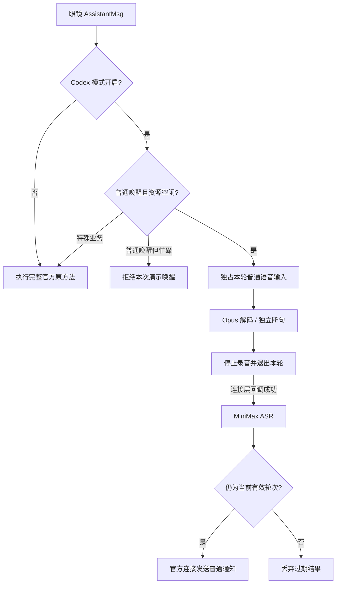
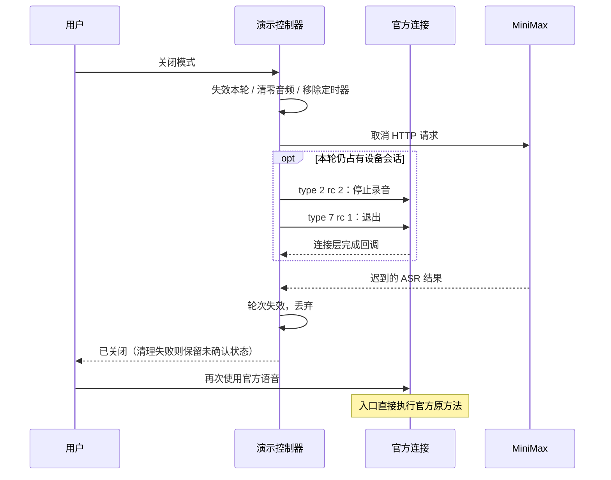

# Codex 模式：ASR → 眼镜通知最小演示

实现范围：以官方 RayNeo AI **1.0.2 (68)** 为底座，在手机开启模式后，用眼镜普通唤醒说一句话，经 MiniMax ASR 识别，原文通过眼镜普通通知回显。**本版本没有调用 Codex，也没有连续对话或 TTS。**

代码、主机测试、真实 ASR 请求及 APK 构建已完成；手机/眼镜验证未完成。2026-09-11 检查 ADB，设备列表为空。不能据此宣称眼镜实际收音、通知显示或全部官方功能回归通过。

## 使用

1. 安装增强包后，从原 `RayNeo AI` 入口登录、连接眼镜；保持只连接一副眼镜。重新签名的包不能覆盖官方签名包，首次安装涉及卸载及本地数据清除，须先处理需要保留的数据。
2. 打开 `Turbo IO`，输入 MiniMax API Key，点“保存到本机”。Key 不回显，可以关闭模式后替换或删除。
3. 在官方设置中自行开启需要的眼镜通知。演示不会修改通知总开关、应用过滤、免打扰或其他官方设置。
4. 点击“开启 Codex 模式”，使用普通语音/按键唤醒，说一句话，停顿约 1 秒；也可点“结束当前这句话”。手机显示识别文本，眼镜收到普通通知。
5. 点击关闭，等到明确显示“已关闭”。若停止/退出指令未确认，会保留清理状态，需重试关闭或在眼镜退出助手，不能把超时当成功。

API Key 保存在 `noBackupFilesDir`，内容使用 Android KeyStore 中不可导出的 AES 密钥进行 AES-GCM 加密，使用 AtomicFile 写入。输入框禁用状态保存和自动填充；增强页禁止截图。Key 不内置、不记录到日志、不上传到自建服务。录音仅在开启模式、接管唤醒后发送到 MiniMax。

模式只保存在进程内，默认关闭，进程重启后关闭。演示不常驻保活；系统杀进程、锁屏后是否能继续本轮依赖实际官方进程生命周期，必须实测。录音和识别文本不写入本机文件，最近文本仅保存在内存。

## 实际入口和协议

| 层 | 1.0.2 代码依据 | 本次实现 |
|---|---|---|
| 分流 | `com.rayneo.rayneo_venus_sdk_plugin.e.c(String, byte[])` 解包 AssistantMsg、分发到 `N7.b$b` | 原方法改名 `turboOriginalC`，增加一个同签名包装方法；关闭时直接调用原方法，原方法体完整保留 |
| 唤醒 | AssistantMsg type 1；枚举 `n` 的 VOICE_A=1、VOICE_B=2、KEY=3 | 仅接管这三种普通唤醒。ONE_SHOT、AGENT、LIVE_AI、SHARED_AUDIO 等保留官方入口 |
| 收音 | type 3 的 data 字段（protobuf field 4）；`K7.c.c()` 指定普通设备 Opus/16 kHz | 独立 `OpusDecoder` 实例解码；不启动官方 AI workflow、不向官方发送 ASR 文本；不根据官方引擎的本地录音标志判定眼镜传输能力 |
| 录音控制 | `A7.K1` case 6：type 2，rc=1 开始、rc=2 停止；`K7.c` 停止路径：type 7，rc=1 退出 | 用现有 CoreConnect 连接直接提交同协议控制消息；单轮停止并退出后才请求 ASR |
| 发送 | `I3.v.h` 已存在的实例、`I3.v.h()` 连接快照、`I3.P` 及 `u(P, Function2)` 回调 | 不创建第二个插件，不替换 Activity，不注册事件队列消费者。通知 business 21/type 2；只有回调成功才显示连接层发送成功 |

资源占用检查读取 `N7.b.d`（仲裁器）、`N7.b.c`（共享音频）、官方运行/模拟状态。开启只校验连接、Key 和独立解码器可用性，进入待命，不要求官方业务此刻空闲；收到普通唤醒时才检查当前音频占用，正忙则拒绝本次收音并显示具体原因，不启动第二套助手。已有官方业务不停止。接收到特殊业务唤醒、眼镜退出或发现官方抢占时，本地会话取消并让出；不补发可能影响新业务的延迟 STOP。跨线程业务切换和设备端实际行为仍须真机验证。

本版断句采用固定能量门限，并非厂商 VAD：16 kHz 单声道 PCM，每 20 ms 窗口计算能量；至少 300 ms 有声后，约 1 秒静音结束；5 秒无有效语音退出；最长 20 秒。Opus 帧最多 4096 bytes，解码输出最多 3840 bytes，队列最多 48 帧，PCM 缓冲有硬上限。嘈杂环境下可手动结束本句，端点效果尚未经过实际眼镜调参。

MiniMax：HTTPS `https://api.minimaxi.com/v1/speech_to_text`，multipart `model=asr-1.0`、`response_format=json`、`stream=false`、`file=16kHz/mono/16bit WAV`，Bearer Key。单轮只有一次付费请求，无自动重试；10 秒连接、30 秒读取、45 秒整轮超时，响应最多 64 KiB。通知正文最多 500 个 Unicode 字符，超出截断并加省略号，手机保留完整识别文本。

## 关闭模式的边界

1. 提升轮次编号、取消录音和 ASR、释放解码器、清零缓冲并移除本地定时器；旧回调不会开始新 ASR 或发送新通知。
2. 尚有本轮设备会话时发送停止和退出，等待回调。失败保留“未确认”，允许重试；已断开连接或官方已取得音频所有权时不向未知/新业务发送 STOP。
3. 通知若已经提交到官方发送层，则无法撤回；关闭会等待该发送回调或超时。这不等于眼镜已经显示或已经移除该通知。关闭阻止的是后续提交，已在传输中的通知仍可能到达。
4. 确认关闭后移除活动路由引用。官方方法继续处理；不保存开启状态、不保留修改后的官方配置。

## 构建与证据

运行 `enhancer/test/run.sh`：实际控制器配合模拟 Android 调度器、连接、ASR、KeyStore 依赖。187 项控制器断言覆盖 OFF 直通、重复唤醒、设备隔离、忙碌拒绝、特殊业务让出、断连、无音频超时、录音结束、取消后迟到结果、通知发送中的关闭、退出失败重试、计时器移除、WAV 和协议边界。另有 Manifest 与补丁幂等拒绝检查。**这些测试没有模拟真实 Android KeyStore、JNI、蓝牙或眼镜固件。**

实际 `MinimaxAsr.java` 在主机使用先前的合成测试 WAV 调通，返回 24 字符，耗时 1183 ms。此结果验证请求编码及服务连通，不证明手机网络或眼镜音频输入已通。

构建工具只接受固定原包 SHA-256。以原 APK 为模板组装，原 ZIP 中只有 `AndroidManifest.xml` 与 `classes2.dex` 改变，新增 `classes4.dex`，签名按本地密钥重新生成。3426 个其他官方文件逐字节相同，其中 3116 个为资源、assets、原生库；`resources.arsc`、`classes.dex`、`classes3.dex` 保留原字节。编译后的 Manifest 除新增控制页，仅允许 aapt 将 platformBuildVersionName 的字符串形式规范化为等值整数；原组件和权限不变。旧 `InProcessRayNeoRuntime`、`CodexBridgeClient` 不打入演示 DEX。

产物：`enhancer/build/output/RayNeo_AI_1.0.2-turbo-debug.apk`；机器校验：同目录 `verification.json`。完整原包留在仓库外，增强 APK 与第三方反编译内容不提交仓库。

## 真机验收门槛（尚未通过）

| 验收 | 必须观察到的结果 |
|---|---|
| 官方基础能力 | 增强包模式 OFF 时，账号、绑定、连接重连、官方语音正常；对照原包排除重签导致的登录/签名校验问题 |
| 演示闭环 | 眼镜真实唤醒、Opus 收音、ASR 正文、眼镜实际通知显示；不能用发送回调代替镜片验收 |
| 关闭竞态 | 录音中、识别中、通知发送中分别关闭；已关闭后新语音只进入官方助手；旧结果不再新增推送 |
| 其他官方业务 | 通话、翻译、录音、全天智记、拍照/视频、通知设置和设备更新等原有功能逐项对照；任何回归都阻止把演示认定为验收完成 |
| 生命周期 | 锁屏、后台、断连重连、进程重启及 Key 保存/删除；重启模式默认 OFF，通知关闭时不私自恢复设置 |

“关闭模式后所有官方功能完全一致”是最终验收要求，**当前只完成实现与静态保护，尚未得到完整真机证据**。如果重新签名本身导致官方服务不可用，不能用当前增强包宣称满足该要求，需要先解决签名依赖或改用保持官方签名的运行时注入路线。

## RayNeoS3 开启失败修正（2026-09-11）

真机非敏感快照：`model=RayNeoS3 running=false mock=false localRecorder=true`。旧 `VendorTransport.requireIdle()` 将 `N7.b.h` 为 true 一律视为不支持，导致这个配置无法开启。

代码链为 `N7.b.h` → `G7.i.invoke()` case 3 → `!M7.a.g()`；`M7.a.g()` 对 RayNeoS3 固定返回 false。这个标志控制官方引擎本地录音/输入配置，不是眼镜是否具有 Opus 上行的能力声明。本次删除该错误阻断，保留官方业务占用、助手运行及模拟模式检查；演示仍通过实际收到的眼镜音频帧和独立 Opus 解码验证输入，不修改官方引擎配置、不启用手机麦克风替代。

新增 13 项测试直接运行真实 `VendorTransport`，用厂商 ABI 形状的桩复现上述真机字段组合；原 187 项控制器断言继续通过。它们验证开启条件与占用保护，不代替眼镜来音和镜片通知实测。增强页恢复时仅记录上述非敏感状态；不读取或记录 Key。

## 待命开关与音频占用分离（2026-09-11）

旧实现对 `G7.E.a/b/c/d`（系统中断、翻译、助手、全天智记）任一为 true 都给出同一句“官方音频业务正在使用中”，并在开关阶段就拒绝开启。本次手机日志只记录 running/mock/localRecorder，没有记录这四个位，因此不能把这一次报错具体归因于通话、翻译或智记。

修正后的边界：

1. 打开模式仅挂上待命路由，不发录音 START、不结束官方业务；界面显示就绪或具体等待原因。
2. 新普通唤醒时检查真实通信音频模式 `AudioManager.getMode()`、当前助手、翻译、智记、共享音频、录音和模拟状态。有占用则不开始收音。
3. `N7.b$b.j()` 的官方实现会调用 `G7.E.d(false)` 复位中断标志。演示在新普通唤醒且上述当前占用检查通过后，调用同一个复位方法，并再检查一遍状态。这个步骤不会在点开关、关闭模式或空闲轮询时执行。
4. 保留收音期间的中断和抢占检查，不清除翻译/助手/智记/共享录音状态。当前普通通知演示仍不支持与全天智记并发收音，显示智记占用时须先在官方端结束该业务。
5. 增强页诊断补全 systemInterrupted/translateActive/assistantActive/alwaysOnActive/sharedSession/sharedTranslate/sharedRecording/pendingRecording/audioMode。日志只包含状态和型号，不记录 Key 或录音内容。

验证：195 项控制器断言、26 项真实反射适配器回归、补丁与 Manifest 不变量检查通过。覆盖忙碌时仅待命、忙碌唤醒无 START、资源释放后下一次唤醒才开始、历史中断复位，以及通话/翻译期间不得复位。本轮只构建 APK，不自动安装；未宣称新的开启和眼镜收音路径已通过真机验证。

## 控制页返回与诊断保留（2026-09-11）

用户反馈进入官方页后无法返回控制页，杀进程又丢失状态。控制页新增独立 taskAffinity 与 singleTask，打开官方 Activity 时使用 NEW_TASK；两个入口仍共用同一进程，通过桌面入口或最近任务切换。定时刷新仅在文字或控件状态变化时更新视图，避免反复覆盖文本选择。

控制页新增唤醒、音频帧、录音控制提交/完成计数，以及“查看诊断记录（重启后保留）”。诊断只记录时间、事件类型、状态位、帧长度和传输回调，不记录 Key、音频、识别正文或设备 ID。私有 noBackup 目录保存最多 80 行、每行 512 字符、文件 64 KiB；超过字节上限淘汰最早记录。异步有界写入，进程立即终止时最后排队事件可能丢失。重启仍默认 OFF，不恢复录音会话。

本轮实证：18:51:18 手机快照 `alwaysOnActive=true`；用户随后确认控制页显示“本次未开始收音：全天智记运行中”，最近识别为空。该文字来自普通唤醒分支的占用检查失败，证明唤醒已进入 Demo，但本次没有发送录音 START、没有开始 ASR。当前须在官方端手动结束全天智记后重新唤醒；补丁不强行停止智记。眼镜显示“请将眼镜连接至手机app后重试”的固件触发原因尚未取得证据，不能将其当作实际蓝牙断连结论。

验证：200 项控制器断言、26 项真实适配器检查、补丁/Manifest 不变量，以及诊断文件重启读取、滚动淘汰、换行清理、中英文容量上限和临时文件替换检查。仅打包，不自动安装；新任务切换和镜片闭环仍待真机验收。
