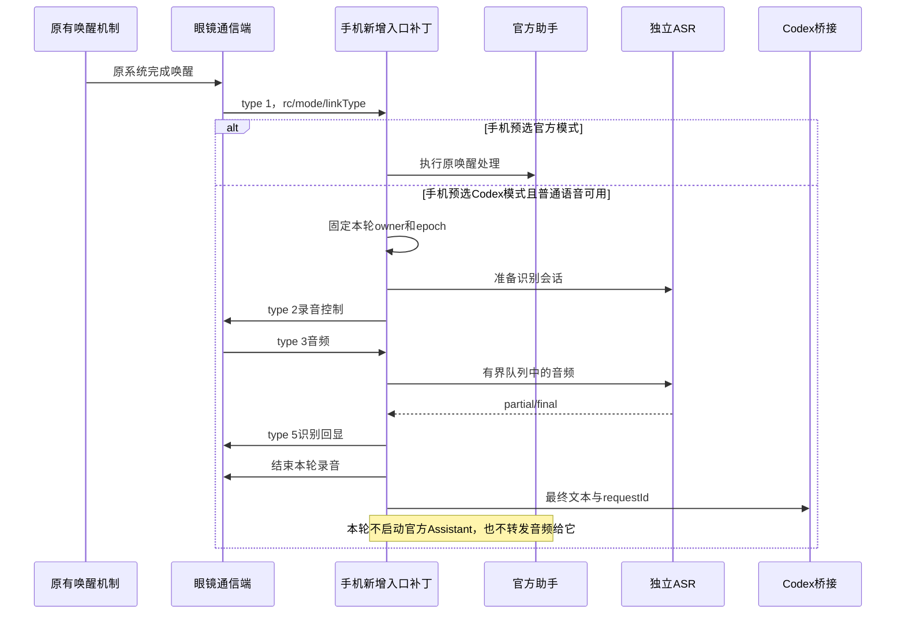
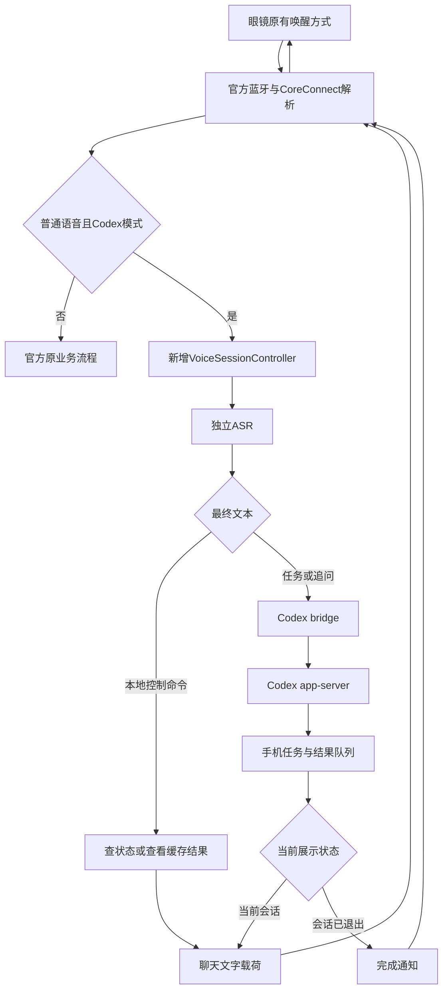
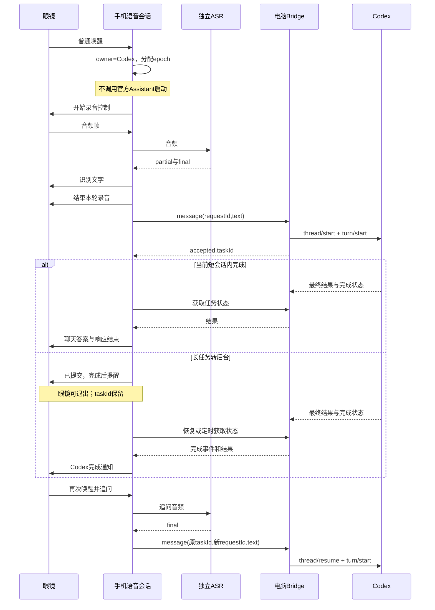

# 眼镜 Codex 交互方案：Android 1.0.2

本方案只覆盖三项：眼镜语音发起 Codex 任务、眼镜接收结果、对同一任务继续追问。采用完整官方 App 加业务入口补丁，复用官方连接；新增独立语音会话与 Codex 适配。第一版采用手机预先开启 Codex 模式、语音输入、文字输出、长任务通知；不依赖官方云端助手扩展工具。

## 1. 已取得的实际样本

2026-09-11 从连接手机的 `com.rayneo.venus.pub` 导出完整 base.apk。包管理器确认 versionName `1.0.2`、versionCode `68`，安装路径仅返回一个 APK；导出后 ZIP 全项完整性校验通过。

- [APK 本地文件](/Users/USER/opensource/rayneo-local-samples/RayNeo_AI_1.0.2.apk)，387,684,631 bytes。
- SHA-256：`32c67abbdf3c87eb113f965f984b79eee17b4bf3136f14f535375752ab1a7093`，与此前调查记录一致。
- [本地反编译目录](/Users/USER/opensource/rayneo-local-samples/audit-1.0.2)，仅保存在项目仓库外。

Jadx 完成 12,244 个类的处理，报告 63 个方法/代码恢复错误；需要的普通语音回调、载荷和发送入口可读。`N7.b` 的大方法另用 simple 模式核对控制流。反编译不是源码重建，也不是运行通过证明。本次只导出安装包，未卸载、重绑、安装增强包或更改手机应用数据。

## 2. Turbo-IO 当前实际实现

| 部分 | 当前代码事实 | Android 采用方式 |
|---|---|---|
| 眼镜语音会话 | StandbyVoiceSession 管理唤醒、录音、识别、处理、展示、下一轮、退出 | 复用状态设计，按 Android 1.0.2 入口重写适配 |
| 自有 ASR | CloudVoicePipeline 发送独立 ASR 请求，处理 final/partial | 沿用独立 ASR 分层；Android 音频格式按实际入口处理 |
| Codex 语音工具 | CompanionVoiceRuntime 注入 toolDefinitions/executeTool；聊天模型选择 codex_message/status/stop | 本需求只要 Codex，省去聊天模型选择工具环节，final 直接交给 Codex |
| 当前任务 | CodexCompanion 保存 selectedTaskID；message 携带 taskId 实现继续任务 | 保存当前任务，支持明确新建和继续 |
| 电脑桥接 | bridge.mjs 使用 thread/start、thread/resume、turn/start、turn/interrupt | 复用现有协议和实现，补可靠事件消费 |
| 主动提醒 | CodexPush 轮询 /v1/state，完成/失败/待确认事件转成眼镜通知 | 借鉴事件去重与通知路径；增加可恢复的结果存储 |
| 连续收音 | 实验开关；单次会话有 120 秒保护，回答后有 10 秒等待策略 | 首版采用逐轮唤醒/继续；连续收音作为后续单独验收项 |
| 输出 | type 5 识别文本、type 32 聊天载荷、type 12 响应结束 | 逐项与 Android 1.0.2 核对，不直接照抄 iOS 字节序列 |

Turbo-IO 的工具返回先告诉用户“已交给 Codex”；任务真正完成由后续状态/通知处理。它不是一次同步 HTTP 请求等待整个 Codex 执行完。其回答编码文件还明确注明未通过镜片验证，因此不能用 iOS 代码存在替代 Android 真机验收。

## 3. 第一版的具体使用方式

### 一次性配置

电脑上启动已有 Codex bridge，绑定一个工作目录和已登录的 Codex app-server。手机增强页配置 bridge 地址、独立访问令牌和 ASR 服务，确认眼镜已在增强包进程中连接，再开启“眼镜 Codex 模式”。工作目录在电脑 bridge 配置；语音不能随意指定任意磁盘目录。

此模式启用期间，普通助手唤醒进入 Codex 会话。关闭该模式后，普通助手唤醒恢复官方流程。选择在手机完成，不要求修改眼镜固件菜单，也不引入新的硬件唤醒词。

### 新任务和追问

示例交互如下，显示文案是拟实现行为，不是已完成的硬件截图：

| 使用者动作 | 系统行为与眼镜文字 |
|---|---|
| 用原有方式唤醒，说“新任务，检查这个项目为什么构建失败” | 显示正在识别；识别结束后发送一次任务，收到 bridge accepted 才显示“任务已提交” |
| 任务很快完成 | 聊天页显示 Codex 最终回答；保留当前 taskId |
| 任务耗时较长 | 先展示“任务处理中，可以退出，完成后提醒”；结束本轮录音和短回复，电脑继续执行 |
| 任务完成但已退出聊天页 | 发送“Codex 任务完成”通知及短摘要；完整结果保存在任务记录 |
| 再次唤醒，说“查看结果” | 展示当前任务结果，不新建 Codex turn |
| 说“为什么会这样？”或“继续，把修复方案给我” | 在同一 taskId/threadId 追加一轮，保留 Codex 上下文 |
| 说“新任务，检查依赖升级” | 新建 thread，切换当前 taskId；不自动停止旧任务 |
| 说“任务进度” | 本地读取 bridge 状态，不把这句提交为代码执行任务 |
| 说“停止任务” | 绑定当前 taskId/turnId 请求 interrupt，展示停止请求状态，等完成事件确认 |
| 原眼镜退出操作或手机结束本轮 | 停止收音、关闭展示会话；电脑任务继续执行 |

控制命令用明确固定句式匹配。普通内容直接作为 Codex 文本，不交给额外 LLM 分类。没有当前任务时普通内容创建任务；有当前任务时普通内容继续该任务。手机页始终显示当前任务并提供新建/选择/停止按钮，避免跨任务混淆。

首版仅允许一个“当前任务”。其他任务可以后台运行和产生带任务标识的通知；收到其他任务通知不会自动切换当前任务。历史任务选择先在手机完成，避免靠不可靠的语音编号匹配切错上下文。

### 回答、长文本和继续提问

第一版承诺目标是**语音输入、眼镜文字输出**。不把 TTS 播报放进这次范围；Turbo-IO 当前页面同样注明无 TTS。答案只呈现最终结果和明确任务状态，不显示模型思考内容，也不把中间工作进度文本当最终结论。

短回答进入当前聊天页；长回答按安全长度分段，手机保留全文。新增“下一段/上一段/重新显示”语音控制，用新展示轮次呈现缓存内容，不再调用 Codex，也不依赖改写眼镜翻页手势。若一次会话已退出，用户按原方式重新唤醒后继续。type 11 是下一轮事件，不能当成任意翻页按钮。

首版采用逐轮录音。支持“收到回答后，通过设备现有下一轮事件或再次唤醒继续问”，不承诺一次唤醒永久开麦。超过交互等待阈值的 Codex 任务必须转后台等待，不能让眼镜一直处在录音或 loading 状态。阈值作为本地配置，根据真机状态超时验收确定；不把 Turbo-IO 的 120 秒/10 秒数值当成 Android 固件规则。

任务仍运行时，现有 bridge 不接受同一 task 的第二个 turn。手机可持久化一条明确待续问，在上一 turn 结束后提交，并显示“已排队”；再次追问不能静默覆盖它。需要立即改变正在执行的任务时，先明确停止、等结束确认，再继续。首版不声称具备实时 steer 能力。

## 4. Android 1.0.2 的接管位置

### 唤醒词检测与任务 ASR 的明确边界

“原有唤醒方式”准确指：设备现有交互触发后，手机收到眼镜上报的 AssistantMsg type 1 唤醒事件。它不是让新增 ASR 长期监听“小雷小雷”或“hey rayneo”。本方案不修改唤醒词检测器、不训练新唤醒词，也不把待机音频持续送到自有 ASR。

1.0.2 的 WakeBean 只有 rc、mode、linkType；唤醒类型枚举包括 VOICE_A、VOICE_B、KEY、ONE_SHOT、AGENT、LIVE_AI、SHARED_AUDIO 等。该接收分支没有唤醒词文本，也没有给出 VOICE_A/VOICE_B 与中文/英文唤醒词的对应关系。代码能够证明手机接收到已发生的唤醒事件；不能由此补写设备固件的唤醒算法、运行位置或具体词表。

第一版在手机设置中预选 Codex 模式，因而路由发生在 ASR 之前：接收普通唤醒事件 → 冻结本轮 owner → 启动独立录音/ASR → 最终文本送 Codex。官方模式则执行原唤醒处理。这里的模式不是根据“小雷小雷”与“hey rayneo”分别选择，也不是先让官方 ASR 识别任务内容再抢走调用。

如果之后要求同一个唤醒词下自动判断“交给官方还是 Codex”，那是另一个流程：先用独立 ASR 得到任务文本，再分类；其中官方完整助手的文字重入路径仍需另外验证。本版不依赖该路径。

ASR 建连期间只使用有界内存音频缓冲；超时或队列溢出则结束本轮并明确报错，不把同一请求自动再交给官方助手。设备是否提供唤醒后的音频预缓冲、能否完整收录紧接唤醒词的一句话，需要真机录音验证；第一版交互应在设备显示可说话状态后再说任务。不能仅凭有 type 1 和 type 3 就承诺零丢首字。

`GlassMessageHelper e.c(...)` 解析 AssistantMsg，type 1/3/8/11 分别进入唤醒、音频、退出、下一轮。它将消息转给具体 `N7.b` 监听器；`N7.b` 的唤醒方法随后调用 startAssistant/initAssistantOnly，音频方法根据 owner 进入 AlwaysOn 或 Assistant 音频路由。

补丁放在已经完成传输协议解析之后、普通助手启动或音频分发之前：只在 Codex 模式且本次属于普通语音会话时交给新增控制器；其他消息保留原逻辑。不能在最底层吞掉 business 13 全部数据，因为其中还有智记和其他控制消息。共享音频、翻译、通话或录音占用时，第一版不抢占这些会话，明确显示忙碌。

关键约束是本次 Codex 会话不调用官方 startAssistant，不给官方 Assistant recorder 喂入本轮音频。不能使用“官方 ASR 回调后屏蔽答案”实现排他执行，因为 ASR 回调不是阻断官方 native/cloud 工作流的事务边界。

新增控制器自己负责录音开始/结束、VAD、ASR final、下一轮和退出，使用独立音频/任务队列。官方 `G7.X0` 已存在 type 2 录音控制发送及回执处理，但还附带默认 native recorder 通知；实施时复用控制消息语义与发送器，避免顺带启动官方 native 处理。不能重复初始化默认 AudioRecorderBridge module。

## 5. 模块与数据流

| 模块 | 具体实现 |
|---|---|
| VersionLockedHookAdapter | 对 1.0.2 指定方法插入条件分流；验证 APK 哈希和签名；不创建第二个官方插件实例 |
| VoiceSessionController | 维护 sessionId/epoch/phase，录音控制、音频队列、ASR生命周期、结束和忙碌处理 |
| StreamingAsrClient | 按实际普通语音入口格式分帧/解码，交独立 ASR；partial 用于回显，final 触发一次提交 |
| CodexSessionCoordinator | 固定当前 taskId、映射 threadId、确定新建/追问、运行中续问排队及本地命令 |
| CodexBridgeClient | 复用 /v1/message、/v1/state、/v1/stop；requestId 持久化并贯穿重试 |
| ResultPresenter | type 5 识别回显，type 32 答案载荷，适用流程的 type 12 响应结束；处理分段与旧会话隔离 |
| TaskNotificationWorker | App 可运行且设备连接时发现任务完成，调用眼镜通知通道；未展示结果持久保存，重连后核对 |

电脑 bridge 基于已有实现，不再增加一次聊天模型调用。已有 Android CodexBridgeClient 的手工配置/提交可以继续用，但其同步网络方法必须迁到后台执行，前台 Activity 不能拥有整个任务生命周期。

Android 后台工作由应用级服务协调；系统要求持续工作时提供相应前台运行状态。进程被系统停止、手机断网或电脑休眠期间不承诺即时通知；恢复后通过持久任务和结果记录恢复。现有 bridge 的内存事件有数量和时间上限，正式交付需补持久结果/事件游标及确认消费机制。传输成功、设备 ACK、实际镜片展示分别记录，不能一律写“已收到”。

## 6. 数据和交互一致性

眼镜会话、ASR 句子和 Codex 任务是三个生命周期。眼镜退出只结束收音和展示；Codex thread 保留上下文；每次任务/追问对应新的 requestId 和 turn。连接重建产生新 epoch，旧回调不能抢占新会话输出。

请求发送前持久化 taskId、ASR roundId、requestId 和文本。网络断开后复用相同 requestId 核对，不因为“没收到响应”重新创建任务。相同文字可以是用户有意说第二次，不能只按文本哈希删除重复。

结果和通知绑定确切 taskId/turnId。一次通知送达不代表用户已阅读；下次说“查看结果”仍能显示。手机选择任务或说“新任务”才改变当前任务，不因为另一任务刚完成就改变追问目标。

需要 Codex 批准操作时眼镜提示“请在手机确认”，在手机显示原始操作详情并绑定 approvalId；本次先不加入语音批准。普通补充问题可以作为后续增强，经专门映射接口提交；不能把所有回答都当新 turn。

## 7. 需要完成的验证与实施顺序

1. **先证明官方底座可用。** 用 1.0.2 增强启动方式验证登录、连接和原普通助手；重签名后原有必需功能回归未通过前，不扩大接管范围。
2. **闭环一轮，不接 Codex。** 验证普通唤醒、实际音频、ASR final，显示固定文字及正确结束。记录官方 Assistant 启动次数/入音频次数为零。这里首先确定录音和镜片协议的实际行为。
3. **接 Codex 单任务。** 先验证只读任务、最终回答和同一 thread 追问，再处理工作区写入及批准。核验请求与结果不会重复。
4. **补长任务。** 退出后继续执行、结束通知、查看结果、电脑离线和手机重连恢复。
5. **补操作细节。** 新建/继续/停止、长答案分段、运行中续问排队、任务选择；最后再讨论连续收音。

这份设计尚未改动运行时代码。已取得 1.0.2 的静态证据；官方底座重签名运行、镜片实际显示、录音解码、长任务后台通知仍是必须实测的交付条件。

## 8. 本次核对的代码入口

- [Android 1.0.2 消息解析与分发](/Users/USER/opensource/rayneo-local-samples/audit-1.0.2/sources/com/rayneo/rayneo_venus_sdk_plugin/e.java:599)：唤醒/音频/退出/下一轮，type 5/32 语义也在该类。
- [Android 1.0.2 N7.b simple 控制流](/Users/USER/opensource/rayneo-local-samples/N7-b-1.0.2-simple.java:823)：startAssistant/initAssistantOnly；音频入口约 586 行。
- [Android 1.0.2 录音控制适配器](/Users/USER/opensource/rayneo-local-samples/audit-1.0.2/sources/G7/X0.java:231)：发送 type 2 与 native recorder 联动。
- [Android 1.0.2 ASR 回调](/Users/USER/opensource/rayneo-local-samples/audit-1.0.2/sources/K7/c.java:248)，[响应完成](/Users/USER/opensource/rayneo-local-samples/audit-1.0.2/sources/K7/c.java:420)：RayClaw 分支发送 type 12，不能不看当前流程直接套用。
- [Android 1.0.2 回答载荷字段](/Users/USER/opensource/rayneo-local-samples/audit-1.0.2/sources/com/rayneo/rayneo_venus_sdk_plugin/SkillPayloadTransportPayload.java)。
- [Android 1.0.2 CoreConnect 发送回调入口](/Users/USER/opensource/rayneo-local-samples/audit-1.0.2/sources/I3/C0837v.java:699)：u 保留发送回调；t 返回 void 不能证明发送成功。
- [Turbo-IO 语音工具接线](/Users/USER/opensource/Turbo-IO/apps/RayNeoCompanion/Sources/CompanionVoiceRuntime.swift:76)。
- [Turbo-IO ASR 和聊天模型管线](/Users/USER/opensource/Turbo-IO/core-probe/Sources/CloudVoicePipeline.swift:33)。
- [Turbo-IO 当前任务与工具执行](/Users/USER/opensource/Turbo-IO/apps/RayNeoCompanion/Sources/CodexCompanion.swift:199)。
- [Turbo-IO 后台结果提醒](/Users/USER/opensource/Turbo-IO/apps/RayNeoCompanion/Sources/CodexPush.swift:55)，[轮询调度](/Users/USER/opensource/Turbo-IO/apps/RayNeoCompanion/Sources/RayNeoCompanionApp.swift:60)。
- [Turbo-IO 会话结束与继续窗口](/Users/USER/opensource/Turbo-IO/core-probe/Sources/StandbyVoiceSession.swift:203)。
- [Turbo-IO 回答编码的证据边界](/Users/USER/opensource/Turbo-IO/rayneo-protocol/Sources/RayNeoProtocol/AssistantAnswerPrototype.swift:3)。
- [电脑 bridge 新建/继续任务](/Users/USER/opensource/Turbo-IO/codex-bridge/bridge.mjs:104)。
