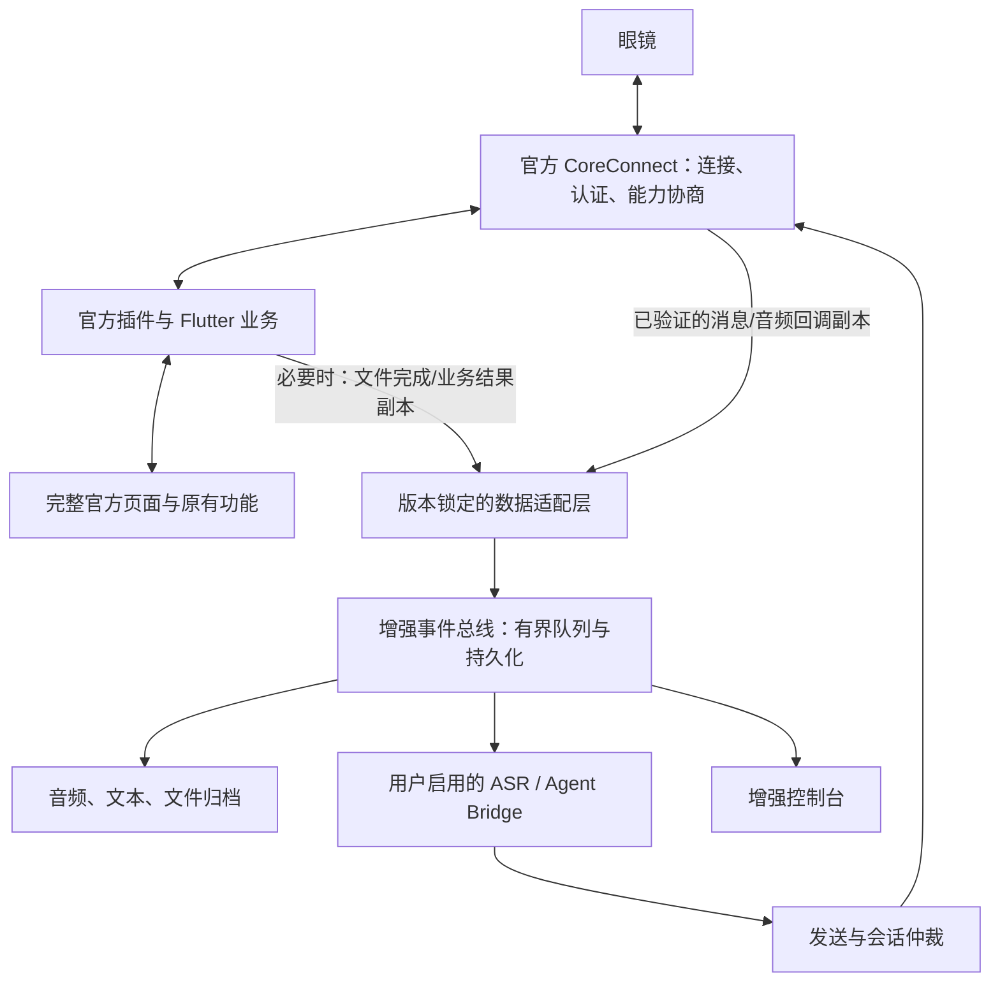

# Android 官方底座增强方案 V2

日期：2026-09-11。状态：设计方案，尚未完成 1.0.2 增强包真机验证。

补充：本页主要是旁路增强草案；命令独占、短路和替换机制以 [V3 点位审阅](HOOK_POINT_REVIEW_V3.md) 为准，未经讨论与验证不继续运行时实现。

## 决策与验收底线

以完整 RayNeo AI Android App 为主体，加入进程内增强模块。官方负责账号、绑定、认证、连接、原有业务与页面；增强模块读取经过确认的数据副本，提供归档、自定义通知和 Agent 接入。不再把独立 PoC 作为产品主线，也不重写一套替代官方功能的客户端。

本次用户明确接受解绑后重新绑定到增强 App，替代调查记录中“不卸载、不清状态”的旧部署约束。**保留全部官方功能仍是硬要求；重新绑定只解决身份迁移问题，不能证明重签后所有官方服务可用。**

先验证“仅重打包重签、无增强行为”的官方底座；只有原功能回归通过，才进入数据接入。如果证书绑定的官方服务拒绝新签名，当前无 root 重签路线不满足目标，应停止将其作为成品路线。届时再评估厂商扩展支持，或在用户愿意使用测试设备及更高权限的前提下研究保留官方签名的进程内扩展；后者不是本方案默认前提，也不保证完整性校验兼容。

## 已确认的问题与证据边界

依据远端 `6e70122` 的 [1.0.2 调查记录](INVESTIGATION_1.0.2.md)，以及本地增强实现审阅：

| 问题 | 已有证据 | 新方案处理 |
| --- | --- | --- |
| 独立 App 缺少设备对象和能力表 | 既往真机记录出现 `abilityBeanNotExist`；官方流程可认证和初始化能力 | 在增强包内通过官方 UI 重新绑定，由官方流程建立完整会话 |
| 系统配对/GATT 被当成本进程可发送状态 | 调查记录区分三层状态 | 发送依据本进程认证、能力和目标业务可用状态；系统状态仅诊断 |
| 消费官方队列 | `InProcessRayNeoRuntime.drainQueue()` 调用 `pollFirst()`；Activity 每 350ms 排空 | 移除该设计，使用独立订阅或明确的回调旁路复制；队列争抢导致的实际丢事件量尚未实测 |
| 改写官方插件生命周期状态 | `initialize()` 写 `plugin.c`，可能创建插件、注册 delegate，并安装 lookup | 官方完成初始化，增强层只附着；不写官方 Activity 字段、不另建连接管理器 |
| 把发送文本当作获取语音的基础 | `sendAsr()` 仅构造并发送 type 5；接收端仅输出 Map 日志 | 单独建立接收、音频解码、识别文本和文件归档链路 |
| 提交不等于送达 | `send()` 直接调用返回 void 的 `core.t()`；增强路径尚未具备完整前置检查及回执状态 | 分开记录提交、SDK 回执、协议回执与镜片显示证据 |
| 数据处理绑定控制台 | `EnhancedActivity` 创建 runtime，销毁时关闭 worker | 进程级协调器持有订阅，Activity 仅观察状态 |
| 网络策略修改作用于整个官方 App | `patch-manifest.mjs` 在未配置时加入全局 network security config | 保留官方网络配置；增强 HTTP 客户端自行限制端点，调试例外单独审计 |

以上代码审阅不等于此次已复现真机故障。当前本机 Downloads 仅发现 1.0.1 原 APK，未在该位置发现 1.0.2；不能用旧样本替代 1.0.2 ABI 验证。

## 产品形态与运行链路

主入口仍是官方 App。第一阶段可以保留独立的 Turbo IO 控制台入口，但打开控制台不再初始化或抢占官方设备运行时。官方业务尚未就绪时只显示状态并引导进入官方页面。

`EnhancementCoordinator` 使用 Application 级生命周期，幂等附着到真正承载通信的进程；先核实 Manifest 和运行日志，不能仅凭包名假设所有业务同进程。官方插件重建后撤销旧订阅再附着；多 Activity 切换不重复订阅。不通过增强模块常驻扫描或另建 GATT 来维持连接。

增强回调只能做有界的数据复制和入队，随后立即返回。解码、网络与文件 IO 在自有 worker 执行。复制 `byte[]`，不能只浅拷贝 Map 后保留可变缓冲区。队列满时记录丢帧并标记会话不完整；异常、断网或关闭增强模块不阻塞官方回调。异常隔离不能消除同进程 OOM/native 崩溃风险，因此内存与载荷大小必须设上限。

## 数据如何取得

暂按实时语音/识别文本、录音文件、设备与消息状态设计；其他官方数据按实际需求增加适配，不能承诺一个通用队列覆盖所有数据。

| 数据 | 首选接入点 | 必须先验证 | 对外结果 |
| --- | --- | --- | --- |
| 连接、认证、能力 | 官方 CoreConnect 生命周期及能力事件 | 回调顺序、连接代次、断线后失效规则 | 结构化设备状态，而非系统蓝牙状态替代 |
| 眼镜上行语音 | 官方解密后的业务消息/音频回调 | Android 是否实际透出音频、分片边界、编码、采样率、序号与时间 | 有界音频流；确认编码后解码，缺帧显式标记 |
| 官方 ASR 文字与 AI 回复 | 官方业务回调；若仅存在于 Dart，则进一步审计 Dart/native 边界 | 文本是否经过 Java 插件，还是只在 Flutter/云端链路中存在 | 带来源的文本事件；找不到接入点时明确记为未取得 |
| 自有 ASR 文字 | 已验证音频副本 → 用户配置的识别服务 | 音频可解码、断续检测、服务协议 | 来源标为“增强 ASR”，不冒充官方识别结果 |
| 眼镜录音文件 | 官方文件传输完成回调与最终文件 | 最终落盘点、临时文件重命名、格式、长度/校验、离线补传 | 原文件保留，自有副本与索引；不对半成品发完成事件 |
| 官方历史数据 | 本包内实际数据库/文件/API 的只读适配 | 数据位置、schema、加密、账号隔离、同步语义 | 单独设计导入；新绑定不能恢复所有旧本地数据 |
| 通知与显示状态 | 官方发送入口、SDK 回调、协议状态回报 | business/type 在 Android 与当前固件上的语义 | 提交状态与设备回报分开；协议状态不是镜片截图 |

iOS 仅作候选协议参考。例如 `Turbo-IO/core-probe/Sources/CoreMessageReceiver.swift` 通过自己的 message delegate 接收 business 13/type 3 音频，并区分 SDK 回执与实际显示；这些是 Android 接入点与测试向量的线索，不证明 Android 接口、编码和回调相同。

若 Java 回调没有目标数据，继续沿官方 native/Flutter 实际处理链找明确边界。不能仅靠增加日志、轮询同一队列或照搬 iOS 字节码解决。接入点未证明前，不进入完整语音产品开发。

## 接入技术与改造范围

优先审计 1.0.2 的 delegate 注册/注销实现：若支持多监听者且分发语义可验证，增加独立 observer，保留全部官方 delegate。仅看到一个 `a(Object)` 方法不足以证明多播安全。

若没有独立观察接口，在**固定样本的少量官方回调方法**植入旁路调用：保留原方法的调用次数、参数、返回值与异常语义，复制自有数据，不替换官方业务分支。补丁位置、方法签名和目标方法摘要必须匹配，否则构建失败。不能继续承诺“官方 DEX 完全不改”同时又依赖未实现的回调注入。

当前 `--no-src` + 新增 `classes4.dex` 只能增加可加载代码，不能自动让官方路径执行新逻辑。新构建流程需要明确的初始化调用点；需要修改 DEX 时采用选择性解码/补丁/重建，并审计改动清单。保留官方 Flutter AOT、资源和 native 库；若必须进一步改动 Dart/native，这应作为新的验证阶段，不能隐含在简单 Java 注入里。

| 现有位置 | 拟改造 |
| --- | --- |
| `InProcessRayNeoRuntime.java` | 替换为只附着的会话读取器、回调订阅与受控发送接口；移除排空队列及插件字段改写 |
| `EnhancedActivity.java` | 只展示状态和设置；删除手动初始化、普通用户任意发包及独立扫描/绑定主流程 |
| 新增版本适配模块 | 锁定 APK 哈希、类/字段/方法描述符、监听语义和补丁位置 |
| 新增事件/音频/归档模块 | 标准事件、会话代次、背压、丢帧、文件完成和持久化 |
| 新增发送仲裁模块 | 目标设备、能力检查、关联 ID、回执、超时和冲突处理 |
| `build-enhanced-apk.sh` | 分离无增强基线包与增强包；初始化补丁、DEX 编号冲突检查、内容差异报告、固定个人签名 |
| `patch-manifest.mjs` | 最小化改动，保留官方组件和网络策略；必要入口不导出数据接口 |

补丁初始保持关闭，兼容性检查失败时关闭增强功能并继续官方流程。使用长期保存的个人签名替代会被意外重建的临时 debug key；后续增强版本沿用该签名。官方 App 升级需重新制作适配包，不能直接覆盖增强版。

## 官方功能与增强功能如何共存

默认使用“官方模式 + 数据观察”：官方语音、通知、录音和其他功能按原逻辑运行。观察模式不自动发送启动/停止录音、ASR、助手退出、通知总开关等控制命令。

第一批增强功能为录音导出、文本归档、控制台状态，以及由用户触发的通知/Agent 文本任务。它们先证明数据可读和消息可确认。

“眼镜语音直接交给自有 Agent”是后续显式模式。需要确认官方会话的退出/暂停边界，再按会话分配唯一发送者，避免官方 AI 与自有 Agent 同时响应。退出增强会话后恢复官方入口。如果尚不能可靠仲裁，先保留手机端手动发 Agent 任务，不能为了 Agent 可用而永久破坏官方助手。

普通通知发送只在确认通知能力、当前设置与用户意图后执行；不再默认修改全局通知开关。发送状态至少区分 `Rejected / Submitted / SDKConfirmed / DeviceConfirmed / Failed / Unknown`，只在实际存在对应回执时推进。SDK 成功不代表镜片已展示；未知结果不自动重发有副作用命令。断连后旧会话的能力和回执不能用于新会话。

## 分阶段交付与停止条件

| 阶段 | 具体交付 | 通过条件 | 未通过时 |
| --- | --- | --- | --- |
| P0 官方功能基线 | 1.0.2 原包校验、官方功能清单、仅重签基线包、原版与重签版对照记录 | 官方账号/绑定/连接/原业务回归；至少完成认证与能力协商 | 证书相关服务失败则停止无 root 重签成品路线 |
| P1 数据接入证明 | 最小旁路补丁、结构化脱敏事件、至少一段真实音频或目标文件的完整链路证据 | 官方原功能仍正常；增强收到真实数据，能识别断线、缺帧和失败 | 无目标数据则继续定位 native/Flutter 接入点，不包装假完成 |
| P2 可用增强能力 | 文件归档/导出、文本时间线、自定义通知、手动 Agent 任务 | 文件能打开、文本有来源、回执正确；增强关闭及故障时官方功能通过 | 修复数据与隔离问题，暂不做语音接管 |
| P3 语音 Agent 与稳定性 | 会话仲裁、自有 ASR/Agent、恢复与后台策略 | 单一响应者、插话/退出/超时恢复；锁屏、重启、网络切换通过 | 不发布语音模式，保留已验证的观察与手动能力 |

P0 清单必须从当前账号和设备的官方页面逐项盘点，不能仅凭 APK 文件存在认定保留。至少覆盖：登录/重新登录、绑定/解绑、连接重连、设备设置、官方助手、录音同步和播放、通知、后台连接，以及 App 实际提供的其他功能（如升级、导航、翻译等，有则逐项测试）。长周期功能或涉及真实升级的项目未测时明确保留未验收状态。

P1 对照三种状态：增强关闭、增强观察开启、增强故障/队列满；比较官方业务成功率、回调数量/顺序、延迟和崩溃。接收录音应校验长度/校验值及可播放性，不能只凭日志有 bytes 判断成功。用合成回放验证重复、乱序、断线、晚到 ACK、背压等边界，再用真机补齐传输证据。

不估计没有证据支撑的完成天数。优先投入 P0/P1，避免先做大量 UI 后发现登录或目标数据接入不可行。

## 迁移和回退

1. 先核对 1.0.2 原 APK 与账号下的官方功能，导出官方支持导出的录音/历史；同包名不等于卸载后本地数据保留。
2. 构建并校验基线包，保存原 APK 与个人签名。只有进入迁移测试时，才由用户在官方界面完成解绑，并按设备实际要求进入配对模式。
3. 卸载旧官方安装、安装同包名个人签名包，通过**保留的官方 UI**重新登录、绑定、认证和同步。不复制/伪造旧绑定对象，不修改 Android ID。
4. P0 通过后，用相同个人签名升级增强包，逐项启用增强能力。
5. 回退时通过可用的官方流程解除增强包绑定，卸载增强包、恢复原版并重新绑定。回退同样不能保证恢复未导出的本地历史。

本次只制定方案和同步仓库，没有执行卸载、解绑、安装、设备控制或 APK 发布。

## 外部依据与当前完成情况

- Android 官方 [应用更新规则](https://developer.android.com/google/play/app-updates)：安装更新受 application ID 和签名兼容性约束。
- Android 官方 [ANDROID_ID 定义](https://developer.android.com/reference/android/provider/Settings.Secure#ANDROID_ID)：Android 8.0 起按签名密钥、用户和设备作用域区分，因此新签名重新绑定是合理迁移路径，不能继承原身份。
- 当前已完成：最新调查记录读取、现有增强调用链审阅、iOS 接收实现参考、路线与验收设计。
- 当前未完成：1.0.2 APK 新一轮反编译审计、重签基线功能回归、Android 音频/文件接入点实证、V2 实现与真机测试。
