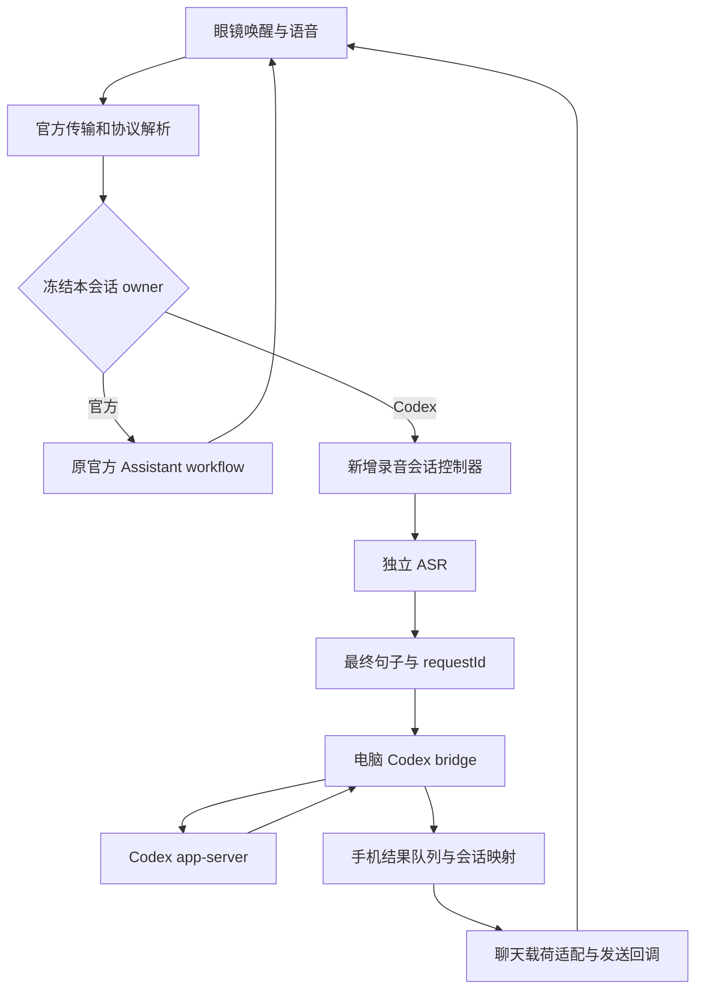
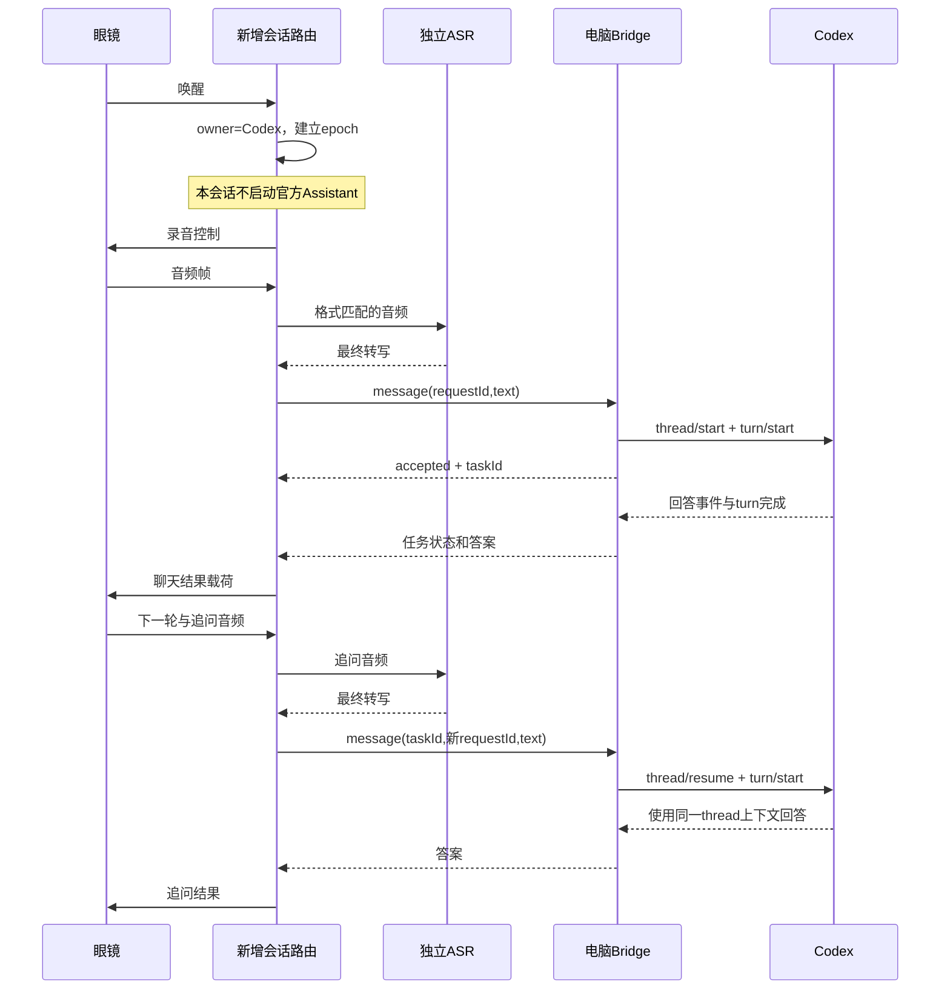
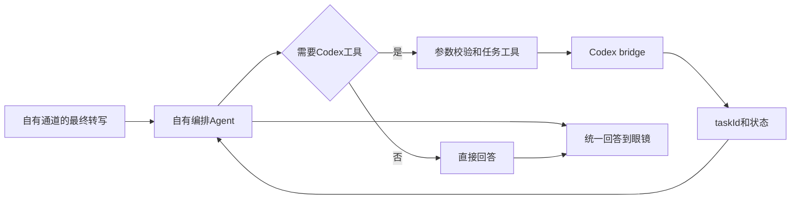
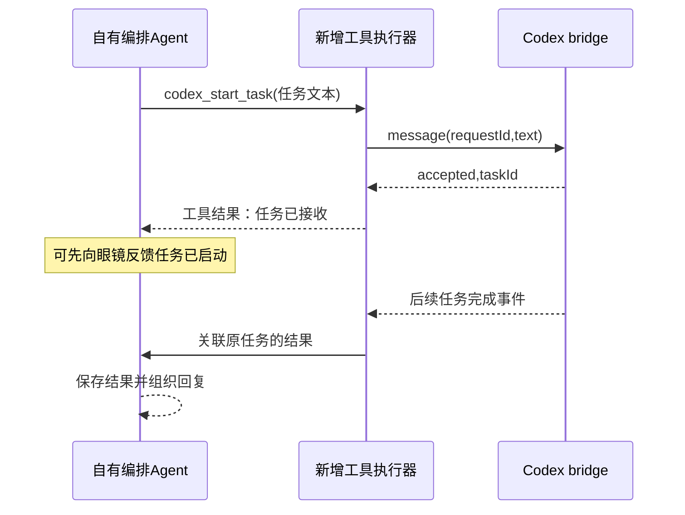
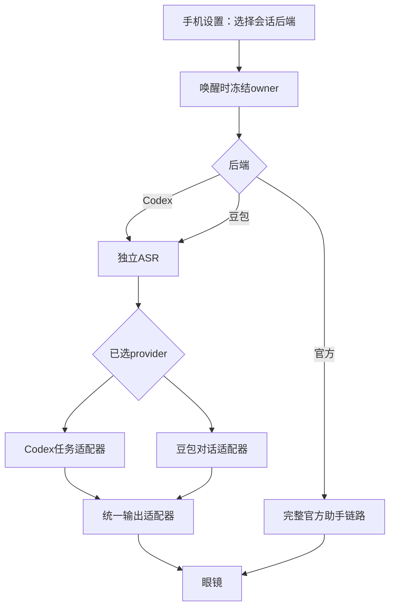
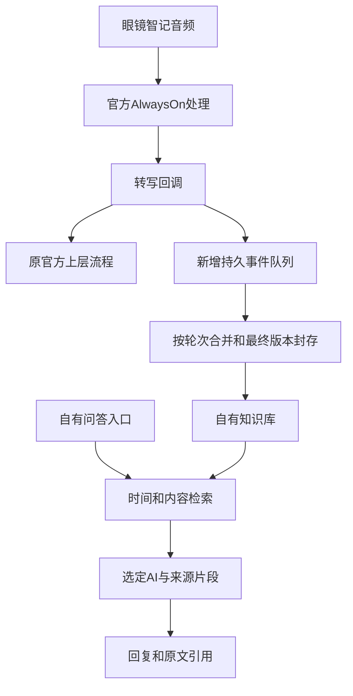
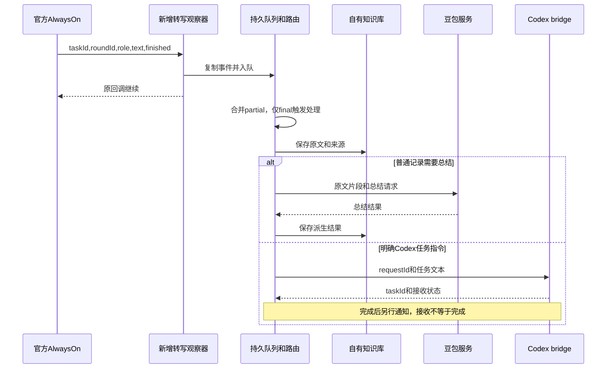
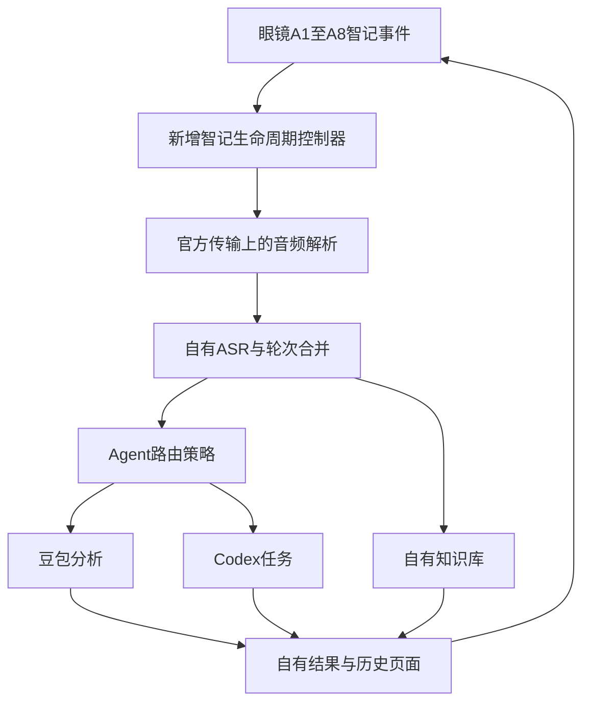

# Android 眼镜 Agent 与全天智记可行性分析

总体结论：**增加自己的 Agent 交互、增加可选择的 AI 通道、用智记转写建立自己的知识库并路由到不同 Agent，具有明确的客户端实现路径。给官方云端 Agent 直接注册新工具，或者把官方智记的数据库和模型原位换成自己的服务，不是现有客户端接口支持的能力。**

“保留官方所有功能”必须作为独立验收条件。保留官方代码只能保留实现，不能证明重新签名后登录、云服务、推送和设备功能全部正常。因此，本报告确认的是指定样本中的数据入口、控制边界和可实施方案，不是增强包已经通过全部真机验收。

## 1. 证据范围与结论表

Android 仓库基线为 `45de234`，已合入远端 `6e70122` 的 1.0.2 调查记录；Turbo-IO 参考基线为 `7e885ba`。本次直接复核的是本地 RayNeo AI **1.0.1 (61)** APK，SHA-256 为 `9149fb0cf41c3007a7aea912657377cc06e719b4c893027087cf5d1097fb2510`。1.0.2 的完整样本不在本地，本机 ADB 设备列表为空。仓库里“1.0.2 的类名仍存在”的历史记录，不能替代本次对该版本方法语义的复核。[1]

以下“可实现”表示数据和控制入口已有代码依据，新增模块有明确实现边界；不表示项目当前已实现或硬件已经验证。“不支持直接替换”限定于已核验客户端接口及协议，不等同于宣称厂商服务器永远无法修改。

| 需求 | 判定 | 可以实现的范围 | 不成立的范围 / 主要卡点 |
|---|---|---|---|
| 1. 眼镜发起 Codex 任务、收回复、继续问 | **可实现，采用新增会话通道** | 音频入口 → 独立 ASR → Codex bridge → 回答下发；用同一 thread 保持多轮 | 当前增强代码没有这条闭环；旁听官方 ASR 不等于阻止官方执行；镜片展示、录音状态和重签名兼容性尚无本次真机通过记录 |
| 2. 给内置 Agent 增加 Codex tool | **部分可实现** | 新增本地“交给 Codex”路由；或自有编排 Agent 注册 Codex 工具 | **现有接口不支持向官方云端模型注册新工具**；工具状态回调不是注册入口。原生接入需要厂商工具扩展接口或服务端工具配置权 |
| 3. 替换内置 AI / 增加选择项 | **增加可选通道可实现；任意模型原位替换不支持** | 手机增强设置提供官方 / Codex / 豆包，按会话独占路由 | `model="codex"`、改 URL 不能把官方协议变成 Codex 协议；手机 APK 修改不能证明眼镜固件菜单可改 |
| 4. 替换全天智记知识库 | **自建知识库可实现；官方知识库原位替换不支持** | 镜像新产生的转写 → 自有存储/索引 → 自有检索问答入口 | 官方检索配置是记录和日期范围，不是知识库连接器；只替换文本回调不能替换云端存储、历史、日历、摘要和原页面 |
| 5. 替换智记 AI，路由到豆包/Codex | **转写之后的自有处理链可实现** | 完整句子 → 路由策略 → 豆包分析 / Codex 任务 / 自有知识库 | 不能把旁路处理描述成官方后台停止处理；若还要求不上传官方音频，需要更早接管录音和 ASR，属于另一套智记运行链 |

## 2. 官方链路中实际具备的能力

### 2.1 语音输入、输出与多轮事件

`GlassMessageHelper`，即 `com.rayneo.rayneo_venus_sdk_plugin.e.c(...)`，解析眼镜的 `TransportMessage.AssistantMsg`。其中 `type=1` 是唤醒，`type=3` 是上行音频，`type=8` 是退出，`type=11` 是下一轮事件；这些消息随后交给 `N7.b` 的具体监听器。它们证明手机侧能拿到眼镜交互事件，不能证明仅注册任意接口实现就能安全接入：原代码会强制转换为官方具体监听器类型。[2]

`K7.c` 的 `AiResultListener.onAsrResult(asr, finished, sid)` 会把识别文本和终止标志发给上层，然后通过 `AsrTextTransportPayload` 发往眼镜。ASR 文本在 Java 层已经可见，不必只从 Flutter 页面或日志提取。[3]

输出必须区分两类：`type=5` 是 ASR 文本，`type=32 / 0x20` 是技能结果载荷。官方 `onNlpResult` 将 answer、query、domain、intent、dialog、round 和 command request ID 等组装为 `SkillPayloadTransportPayload`。现有项目的 `AssistantWire.asrText()` 只构造 type 5，不能据此声称已经实现 Agent 回答卡片，也不能把它当成给官方 AI 输入文字的接口。[2][3][4]

`AssistantController` 的 ASR/NLP 回调来自 native runtime，并由 `ShareHandler` 异步分发。Java 层收到 ASR 后再决定是否调用 Codex，并没有一个已证明会阻止 native/cloud 后续处理的事务边界。要满足“一句话只交给一个执行者”，应在唤醒和音频进入官方助手前确定归属。[5]

### 2.2 工具通知、客户端动作、工具注册是三种接口

官方的 `RayClawToolCallInfo` 只有 `callId / status / toolName / displayName`。它没有参数、工具 schema、执行回调或工具列表写入接口。`onRayClawToolCallInfo` 的具体实现也是将这四项转发给上层。[6]

与此同时，客户端确实支持处理官方下发的动作：`NlpCommand` 有命令名、参数、request ID；`NlpCommandResult` 有执行状态、结果和错误信息；`AssistantController.sendCommandResult(...)` 及 AskAI 对应路径可以回传结果。这是“执行服务端已选择的客户端动作”的闭环。[5][7]

native `libconnect_core.so` 内嵌的 protobuf 描述进一步区分了两者：

| 协议对象 | 已核验字段 | 能证明的能力 |
|---|---|---|
| `RayClawToolCall` | callId、status、toolName、displayName | 工具执行状态展示 |
| `RayClawClientAction` / Workflow Node | callId、needResponse、name、params 等 | 服务端下发客户端动作 |
| `RayClawClientResult` | callId、status、result、errorMessage、text | 客户端反馈动作执行结果 |
| `RayClawChatRequestBody` | text、messages、model、clientResult、referConfig 等 | 发起对话和反馈动作结果；**没有 tools/schema 注册字段** |
| 语音 `Config` | 音频格式、采样率、音色、语言、mode、dialogId 等 | 语音会话配置；**没有工具注册字段** |

以上是二进制中的结构描述，不是根据命名猜测接口。对应原始库 SHA-256 为 `844cd746bd6be1d5d0fcc47c0700c2e0b76d623d765845ae936aeba455ccd86b`；描述符偏移及字段清单见证据附件。[8]

`INlpInterceptor.intercept()` 也不能作为新增工具注册接口。官方 `G7.M0` 会修改既有 intent/domain/nextRound 并返回 true，因此 true 不能直接等同于“取消官方云端执行”。[9]

### 2.3 全天智记的数据面与知识面

`AlwaysOnController` 将 native 结果交给 `AlwaysOnResultListener.onAlwaysOnResponse(...)`。`I7.h.b` 进一步发出 `taskId / role / text / roundId / finished`。因此，新增转写镜像、摘要处理和自有知识存储具备直接数据源。[10]

全天智记还存在区别于普通语音的音频生命周期：A1/161 唤醒、A2/162 开始录音控制、A3/163 实时音频、A4/164 缓存音频、A5/165 退出、A6/166 异常退出、A7/167 请求缓存、A8/168 实时页面状态。A3 会被拆成结构化帧后交给监听器，A4 具有 taskId 和结束标志。**只抓 A3 不构成完整离线补传支持。**[2]

`I7.h.f(...)` 在音频归属判断之后，把音频和 VPU/VAD 标志交给 `AudioRecorderBridge`；该类自动创建的眼镜智记配置使用 Opus、16 kHz，并默认映射 `guest=0`。这证明有音频和角色标签，**不证明标签就是佩戴者实名，也不支持宣称已能准确区分“只有我说的话”**。[10]

知识检索是另一条路径。`G7.C0760u.c(Map)` 构造 `RayNeoAskAIParams`；`referConfig` 包含 global、items、selectIdList，以及按日/周/月的范围。native 的 `ReferConfig` 与之对应。它们定义检索哪些官方记录，不定义连接哪一个外部数据库。[11][8]

`RayNeoAlwaysOnConfig` 以及 native `always_on.proto.Config` 包含语言、音频、角色、taskId、超时等，没有知识库地址或推理模型字段。Flutter AOT 另含 lifelog repository、日历、日记、历史和位置相关路径，但路径字符串只作为存在额外业务面的线索，不能当成已恢复的 API 契约。[10][8]

## 3. 需求一：通过眼镜完整使用 Codex

### 结论与技术方案

可实施方案是**官方 Android App 内增加独立 Agent 会话控制器**，复用官方设备连接，新增 ASR、任务映射和回答适配。Codex 运行在已登录的电脑/服务器上；手机负责语音和设备会话。模型生成文本不等于执行 Codex 任务，两者必须通过任务协议桥接。

建议先提供手机上的会话模式选择：官方、Codex、豆包。在一次唤醒到达时冻结本次会话的 owner。选择 Codex 的会话不启动官方 Assistant workflow，也不把该会话音频继续送给其 native recorder。普通设备业务和协议 ACK 继续走官方实现。

新增 ASR 有两个具体落点：一是使用已有独立 `ASRTask.initTask(config, recorderAdapter, listener)`，给它独立任务名和 recorder module；二是将官方音频解析链交出的帧按格式解码，再接自有 ASR。第二条避免依赖官方助手内部的 ASR→NLP 编排。不要第二次注册同名 AudioRecorderAdapter，因为 `AudioRecorderBridge.init(module, adapter)` 会先释放原 module。[12]

会话控制器必须完成录音开始/停止、VAD 状态、退出与下一轮控制，不能只吞掉唤醒然后等待音频。实现时沿用已识别的官方录音控制载荷和事件语义；分帧和采样参数由实际入口配置决定，不能把整个 AssistantMsg 当作裸 PCM 或单个 Opus 帧。

转写最终句子提交给现有 Turbo-IO `codex-bridge/bridge.mjs`。新任务调用 `thread/start`，追问使用已保存的 taskId，经 `thread/resume` 后在同一 thread 调用 `turn/start`。桥接代码已经包含这条映射，并消费增量回答和 turn 完成事件；这与 OpenAI app-server 文档一致。[13][14]

新增 Android 输出适配器将回答构造成官方聊天结果载荷，走官方发送入口；长文本分段并保留完整答案在手机。TTS 是单独的输出适配项：语音合成、音频焦点、播放路径和结束回执必须独立验收，不能用文字显示成功代替。眼镜会话退出后，任务仍可继续；结果进入待呈现队列，恢复连接或下一次唤醒时按任务展示。

### 流程图

### 时序图

### 多轮与防重复的工程约束

新增映射至少保存 device session、owner、epoch、ASR round、taskId、threadId、turnId、requestId 和最后呈现位置。系统重连不得把旧音频当新请求；用户连续说两遍同一句话也不能仅按文本去重。ASR partial 用于展示，final 才提交；同一轮的修订不自动创建第二个任务。

已有 bridge 的请求日志会在执行前落盘，重试复用 requestId，避免盲目重放。但它不是全链路 exactly-once 证明：连接中断时必须核对任务状态；它当前还有任务数、操作记录数和有期限的内存事件队列上限。交付版需要持久化待呈现结果、显式确认消费，并提供清理策略，不能把当前轮询描述成无限离线推送。[13]

同一 task 正在运行时，现有 bridge 会拒绝再发一轮；第一版采用“等待完成或明确停止后追问”。眼镜离开对话页与停止 Codex 是两个动作。停止必须绑定确切 turn；旧 turn 的延迟结果不得覆盖新会话。Codex 请求操作批准或补充问题时，第一版在眼镜提示、手机展示详情；不把日常智记中的“好的”自动解释为执行批准。

## 4. 需求二：给内置 Agent 增加 tool

### 直接注册：现有客户端接口不支持

给官方模型增加真正的 Codex tool，需要让模型获得工具名称、参数 schema、触发语义，并在生成调用后把参数送往客户端执行，最后将结果放回原模型上下文。已核验链路只有官方下发动作及结果反馈，没有向官方注册新工具的协议字段。因此，**“增加一个监听器，就让官方 AI 自主选择 Codex”不可作为可行方案。**[6][7][8]

修改本地离线 regex 规则可以识别固定句式；APK 中确有 `sherpa_skills.json`，含 domain、intent、commands 和 slots。但修改规则不会给官方云端模型注册工具，规则匹配的后续命令还需要本地 handler 和可用结果反馈路径。不能将规则技能扩展与大模型 function calling 混为一谈。

替换官方已经下发的某一个客户端动作 handler 是另一种有条件的技术扩展：拦截动作、调用自有服务、按原 commandRequestId 回传结果。它只能覆盖该动作的既有参数和语义，不能让模型自然地产生任意新的 Codex 工具调用；将已有日历等命令偷换成 Codex 还会破坏原功能，不采用这种做法。

### 可行替代：自有编排 Agent 加 Codex 工具

将自有通道的第一层设为支持工具调用的编排模型，注册自定义 `codex_start_task`、`codex_get_task`、`codex_continue_task`、`codex_cancel_task`。工具由新增 Gateway 实现，不能直接把模型给出的字符串当 shell 命令运行。火山引擎官方 SDK 的 Chat completion 接口具有 tools、tool_choice、stream 参数，可作为豆包服务接入层；具体部署选择具备对应能力的模型。[15]

长任务工具立即返回 taskId 与 accepted；编排层用查询或事件取得后续结果。工具返回的是任务状态，不冒充任务完成。工具结果和原提问保留在自有编排会话中，因此能够继续问“刚才那个任务怎样了”。这实现的是**新增 Agent 拥有 Codex 工具**，不是官方云端 Agent 已被扩展。

若目标必须是“官方云端模型自己选择新增 tool”，下一项必需资源是厂商提供的工具注册能力或服务端配置权；本地增加代码不能替代这个条件。

## 5. 需求三：替换或选择内置 AI

### 可实现范围

在手机增强设置中增加后端选择，按会话切换官方 / Codex / 豆包，并通过眼镜原有语音入口交互。这是对手机路由的替换，不要求修改眼镜固件。切回官方时走完整原助手链路，确保原有能力仍可访问。

选择器必须分离 ASR provider、Agent provider、知识库 provider 和 TTS provider。Codex 的职责是任务执行和对话，不承担音频识别或知识索引。不能用一个“模型 URL”承担这四类协议。

`AiAgentConfig.model` 和 `RayNeoAskAIParams.model` 是官方服务请求参数；设置成 Codex 并不会创建 app-server thread。`RayNeoServerConfig.customUrl` 虽然存在，但官方传输还有自己的 protobuf、会话、音频状态、工具结果和鉴权语义。直接把地址换成 `/chat/completions` 或 Codex bridge 会产生协议不匹配。[5][8][11][14][15]

可以另做兼容官方协议的 Gateway，但那意味着实现官方的 config/ASR/TTS/状态和结果协议，并验证所有调用方；它不是“改 URL”本身就完成的能力。本方案选择在手机业务边界新增 provider adapter，避免把整个官方云服务伪装成一个通用聊天接口。

首版不采用“任意一句话先让官方 ASR 识别，再决定是否屏蔽官方 AI”，因为回调没有提供原子阻断边界。也不把“独立 ASR 后把普通话语重新送回官方完整语音助手”作为必需路径：已核验 `RayNeoWorkflowParamType` 只有 Unknown/TTS；AskAI 文本接口存在，但不等同于完整语音助手的文本重入接口。

“在眼镜固件自己的菜单里出现 Codex”“自定义固件唤醒词”和“Codex 模式自动继承官方全部工具”均不在本次客户端代码证据支持范围。可交付选择项先位于手机增强设置；官方功能通过官方模式保持可用。

## 6. 需求四：全天智记知识库替换

### 可实现：自有镜像知识库和自有检索入口

在 `onAlwaysOnResponse` 原回调旁边复制结构化事件，先写持久队列，立即返回；不取走官方消费队列中的元素。官方继续接收原事件，自有服务增量建立另一份知识库。

记录主键采用账户命名空间、device session、taskId、roundId、role；同时保存文本版本、finished、接收时间和来源。如果没有可用设备时间，就明确标注接收时间，不能伪造说话时间。partial 更新当前草稿，final 封存当前版本。断线重传和修订按同一键合并，语义摘要和向量索引可以重建，原文是事实来源。

新增 KnowledgeService 提供 `ingest / search / get source / delete`。存储包含原文、时间、角色标签和版本；第一版全文检索即可支撑明确关键词与时间过滤，后续可增加向量索引。检索出的片段及来源 ID 交给所选 AI，回复能够回链到原始记录。

这个模式能覆盖**启用之后实际收到的转写数据**。它不会自动迁移所有既有历史、照片、位置、日历与云端摘要。缓存音频需要单独走 A4/离线恢复处理。官方记录删除也不会自动删除镜像，新增界面必须明确数据来源并提供自有删除/重建控制。

### 不支持的直接替换范围

把 `referConfig.selectIdList` 改成自有数据库 ID 不会让官方服务访问数据库；设置 customUrl 也不会迁移日记、事件、日历等存储逻辑。原位替换要求同时覆盖记录写入、历史查询、检索范围、索引、摘要生成、日历/事件、删除语义以及原 Flutter 页面依赖的响应契约。当前没有这套完整服务契约和官方服务端实现证据，不能把它承诺为现有增强模块的一项配置能力。

若要求自己的数据是唯一来源，采用第七节的自有智记管线，并提供新增历史/检索页面。官方智记页面仍属于官方数据体系，不能在不接管其仓库及 API 的情况下自动展示自有知识库。

## 7. 需求五：智记内容路由到豆包、Codex

### 方案 A：保留官方采集与转写，增加后处理

这是现有代码证据最充分、改动范围最小的方案。最终转写进入自有队列，路由策略判断用途：普通记录入库；需要总结的片段交豆包；明确的任务指令交 Codex。每条记录保存 route decision 与 idempotency key，避免 ASR 多次回调重复执行。

对话录音是输入材料，不是全部都要执行的命令。若确实要把每一句发送给豆包，可以设为“分析/整理”；Codex 任务默认采用显式调用前缀或主动任务模式。这保证“我昨天说要删除文件”作为记忆材料，不会自动变成一次删除任务。

豆包接入指使用方舟服务 API；Codex 接入指使用电脑上的 task bridge。两者的会话和鉴权独立，不能承诺自动继承豆包消费端 App 的个人历史，也不能把所选模型称为 Codex 本身。[13][15]

方案 A 是后处理替换，**官方 AlwaysOn workflow 仍在工作**。它不满足“音频和记录完全不经过官方处理”的额外要求。Android 收到最终转写时，native workflow 已经处理了输入；阻止上层显示不等于撤回此前处理。

### 方案 B：自有采集、ASR、存储与 AI

如果要求整个智记 AI 链改为自己的，需要在进入官方 AlwaysOn native workflow 之前分流音频，并由新增 AlwaysOnSessionController 负责 A1–A8 对应生命周期。实时 A3、离线 A4、缓存请求、结束、异常、连接恢复都要实现；还要与普通语音、通话、翻译等抢占规则协作。之后用自有 ASR、KnowledgeService 和 AgentRouter 完成全链。

原始音频入口和控制载荷存在，因此这条路线具备实现基础；**当前项目没有自有智记录音状态机，也没有本次连续运行、离线恢复或设备续航的验证证据，不能判定它已满足“全天稳定运行”。** 尤其 `role`/VPU/VAD 标签不能直接当作可靠佩戴者身份。要求只路由佩戴者语音时，必须增加并验证身份/声源判定，否则交付范围只能写成“已采集对话的转写”。

方案 B 中被替换的智记会话不再运行官方 AlwaysOn。其他官方功能通过原链路保留；但同一段自有智记不会自然出现在官方云端历史中。要求既完全不走官方数据处理、又无改动保留官方云端智记结果，是相互冲突的产品条件。

## 8. APK 增强的共同实现边界

部署方向仍是以完整官方 APK 为底座，新增 DEX/资源和少量明确业务点位补丁，再重打包、重新签名。不是把 Flutter/Dart 和 native runtime 全部反编译后重新手写。官方登录、设备连接和未接管功能继续由原代码负责；新增代码负责设置、会话归属、ASR/provider adapter、任务和知识队列。

现有 `build-enhanced-apk.sh` 用 `apktool -s` 保留原 DEX，增加 classes4.dex 和 Activity，**没有实现上述原方法的条件短路补丁**。仅增加 Activity 不能完成独占语音路由。实施版必须在原业务入口插入 version-locked 的 before/after 调用，并保证默认路径调用原逻辑。[16]

更具体地，新增模块应具备下表边界：

| 模块 | 新增职责 | 保留的官方职责 |
|---|---|---|
| HookAdapter | 只在已审计方法进入/退出时观察或短路 | 协议收发、配对、认证、ACK/重试 |
| VoiceSessionRouter | owner/epoch、录音控制、任务会话映射 | 非接管语音和其他设备业务 |
| ASRProvider | 独立识别与最终句子 | 官方模式的原 ASR |
| AgentGateway | Codex/豆包适配、工具执行和状态 | 官方云端 Agent |
| OutputAdapter | 自有答案载荷、分段、发送状态和TTS协调 | 官方原发送器与设备能力协商 |
| TranscriptJournal | 持久化、去重、版本、重试 | 原回调的消费与官方数据流程 |
| KnowledgeService | 自有入库、检索、来源、删除 | 原官方知识库及其页面 |

不要沿用现有 `InProcessRayNeoRuntime` 对官方事件队列的 `pollFirst()` 来获取数据，也不要另建官方 plugin 单例或改写其 Activity 归属作为常规启动手段。这些行为会竞争原消费者或生命周期；实施版只绑定已存在的实例，在调用边界复制必要数据。[17]

重新绑定解决的是设备关联条件，不能消除签名改变的影响。Android 的更新安装要求匹配签名，增强包不能直接覆盖原签名安装。[18] 重签名后厂商云服务和各 SDK 的兼容性必须逐项实测；本报告没有实际拒绝日志，因此不宣称厂商一定会封锁，也不宣称一定全部可用。若任一必需官方功能因签名不可用，无 root 重签名路线即不满足“原功能全保留”的验收条件，应停止扩展；保留官方签名的受控运行时注入属于另一种需要设备权限的部署路线，不是普通 APK 安装能力。

## 9. 开工顺序与否决条件

先完成可否继续的验证，再扩大功能面。每阶段都有独立失败条件，不以“代码能打包”代替通过。

| 阶段 | 必须通过的结果 | 失败时的决定 |
|---|---|---|
| 0. 目标版本基线 | 取得实际 1.0.2 样本，核验 SHA/ABI/入口，原包功能基线记录 | 不把 1.0.1 反射表直接用于 1.0.2 交付 |
| 1. 官方功能保留 | 增强启动后登录、绑定、连接、原 AI、智记及设备实际支持的媒体/通知/升级等必需功能回归 | 重签名路线不能满足要求就停止，先处理部署方式 |
| 2. 只读观察 | ASR 和智记 final 被新增队列接收，原功能无丢事件、重复回调或生命周期破坏 | 不进入接管模式 |
| 3. 单轮独占 | 一次选定 Codex 的语音，官方 Assistant 启动/入音频计数为零，自有任务只创建一次 | 禁止用最终回答屏蔽伪装独占成功 |
| 4. 回复与追问 | 实际镜片显示结果；同一 thread 连续追问；退出/停止/断线/旧结果隔离正确 | 不发布“眼镜完整交互”能力 |
| 5. 智记镜像 | 实时、修订、重复和缓存恢复有明确处理，自有检索能返回原文来源 | 不发布“完整知识库替换”表述 |
| 6. 自有智记全链 | 自有ASR、A1–A8、音频抢占、长时间运行、断线恢复和耗电验证 | 保留方案 A，不承诺全天独立运行 |

本次已运行现有 Codex bridge 的 15 个测试，全部通过，覆盖防重复提交、过早完成、旧轮次输出、授权请求、重启请求日志、HTTP 鉴权及有界事件队列。这是 **mock RPC / 本地 bridge 测试**，不是当前 Codex 实例、Android App 或眼镜端到端测试。[19]

推荐讨论基线是：**官方完整功能保留为一个可回切通道；新增 Codex/豆包独占语音通道；全天智记先镜像转写，自建知识库和后处理。** 官方云端 tool 注册、官方知识库原位替换、自有全天采集分别是独立范围，不放进第一版默认承诺。

## 10. 代码与协议证据索引

本地反编译文件位于临时审计目录，行号只适用于该次输出；混淆前类名、方法签名、APK 哈希和 native 描述符偏移才是重新复核定位依据。大方法的 simple 输出是控制流阅读材料，不是可编译源码。附件保存结构字段摘要，不包含完整 APK、厂商密钥或个人录音。

1. [1.0.2 调查记录](/Users/USER/opensource/Unofficial-IO-Android/docs/INVESTIGATION_1.0.2.md)，样本、版本及历史真机失败边界。
2. [GlassMessageHelper](/private/tmp/rayneo-101-audit/sources/com/rayneo/rayneo_venus_sdk_plugin/e.java:315)，消息语义；入口约 571 行，A3/A4 分发约 799 行。
3. [Assistant ASR 回调](/private/tmp/rayneo-101-audit/sources/K7/c.java:248)；[NLP simple 控制流](/private/tmp/rayneo-assistant-simple.java:445)，结果载荷构造约 578 行。
4. [当前 AssistantWire](/Users/USER/opensource/Unofficial-IO-Android/enhancer/src/io/turboio/enhanced/AssistantWire.java:10)，只有 ASR 下行编码。
5. [AssistantController](/private/tmp/rayneo-101-audit/sources/com/rayneo/airuntime/controller/AssistantController.java)，workflow、native 回调、NLP interceptor 与命令结果；[WorkflowParamType](/private/tmp/rayneo-101-audit/sources/com/rayneo/airuntime/controller/RayNeoWorkflowParamType.java)。
6. [RayClawToolCallInfo](/private/tmp/rayneo-101-audit/sources/com/rayneo/airuntime/controller/RayClawToolCallInfo.java:9)；[工具状态分发](/private/tmp/rayneo-101-audit/sources/K7/c.java:402)。
7. [NlpCommandResult](/private/tmp/rayneo-101-audit/sources/com/rayneo/airuntime/controller/NlpCommandResult.java:10)；[AskAI 命令反馈](/private/tmp/rayneo-101-audit/sources/G7/C0760u.java:376)；[语音命令反馈](/private/tmp/rayneo-101-audit/sources/G7/C0727h.java:71)。
8. [native 协议结构摘要](/Users/USER/opensource/Unofficial-IO-Android/docs/evidence/feasibility-native-schema-fields.txt)：`always_on.proto` 偏移 `0x749e34`、`rayclaw.proto` 偏移 `0x74bd18`、`voice_rayclaw.proto` 偏移 `0x750804`。字段来自该样本内嵌 FileDescriptorProto；偏移限定于附件记载的库哈希。
9. [官方 NLP interceptor](/private/tmp/rayneo-101-audit/sources/G7/M0.java:27)，修改既有意图行为，不能作为工具注册证明。
10. [AlwaysOn 回调](/private/tmp/rayneo-101-audit/sources/I7/h.java:185)；[音频入 native](/private/tmp/rayneo-101-audit/sources/I7/h.java:847)；[眼镜默认配置](/private/tmp/rayneo-101-audit/sources/I7/h.java:1018)；[AlwaysOnController](/private/tmp/rayneo-101-audit/sources/com/rayneo/airuntime/controller/AlwaysOnController.java:43)。
11. [AskAI 参数构造](/private/tmp/rayneo-101-audit/sources/G7/C0760u.java:111)；[RayNeoServerConfig](/private/tmp/rayneo-101-audit/sources/com/rayneo/airuntime/controller/RayNeoServerConfig.java:10)。
12. [ASRTask](/private/tmp/rayneo-101-audit/sources/com/rayneo/airuntime/controller/ASRTask.java:220)；[AudioRecorderBridge](/private/tmp/rayneo-101-audit/sources/com/rayneo/airuntime/bridge/AudioRecorderBridge.java)，module 初始化及替换行为。
13. [Turbo-IO bridge](/Users/USER/opensource/Turbo-IO/codex-bridge/bridge.mjs:93)，once/message/resume/stop/event；以本地 `7e885ba` 为复核基线。
14. OpenAI，[Codex App Server](https://learn.chatgpt.com/docs/app-server)，thread/resume 与 turn/start；2026-09-11 查阅，由官方开发文档链接重定向。
15. 火山引擎，[官方 Python SDK：Chat Completions](https://github.com/volcengine/volcengine-python-sdk/blob/master/volcenginesdkarkruntime/resources/chat/completions.py)，messages/model/tools/stream 和 `/chat/completions` 调用，2026-09-11 查阅。
16. [增强 APK 构建脚本](/Users/USER/opensource/Unofficial-IO-Android/enhancer/build-enhanced-apk.sh:30)，保留原 DEX 并增加 classes4.dex。
17. [现有进程内运行时](/Users/USER/opensource/Unofficial-IO-Android/enhancer/src/io/turboio/enhanced/InProcessRayNeoRuntime.java:38)，初始化及事件队列消费。
18. Android Developers，[Sign your app](https://developer.android.com/studio/publish/app-signing)，Signing considerations，2026-09-11 查阅。
19. [bridge 测试](/Users/USER/opensource/Turbo-IO/codex-bridge/bridge.test.mjs)，本次 `node --test codex-bridge/bridge.test.mjs`：15/15 通过。
