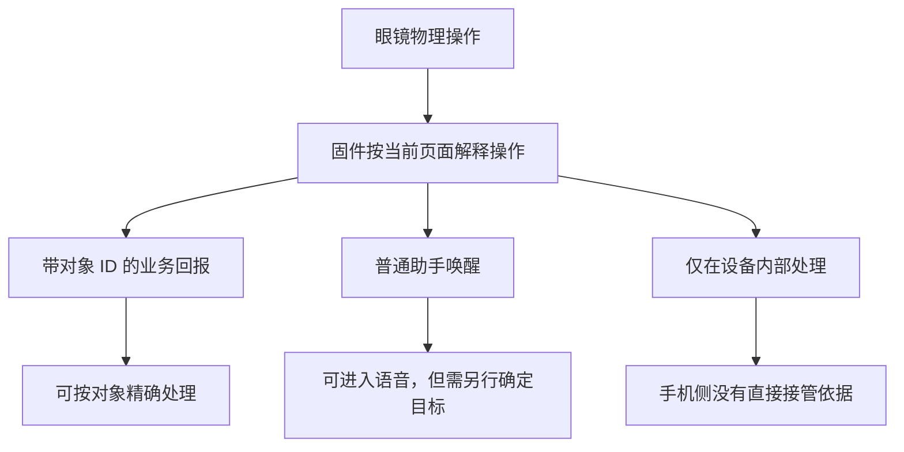
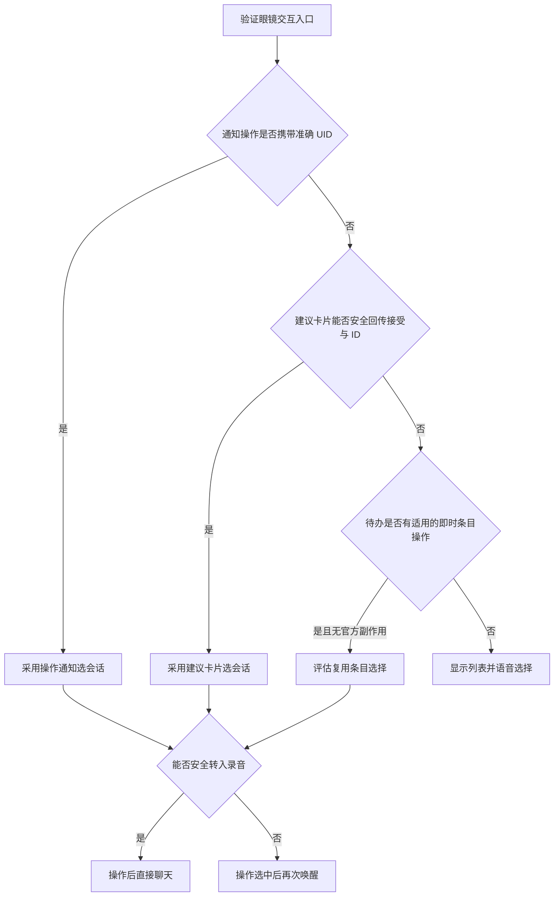

# 眼镜 UI 交互选项与验证方案

## 目标与结论

核心目标：在多个 Agent 会话并行存在时，能够直接操作眼镜上的某条结果，进入对应会话继续聊天；同时提供在眼镜上浏览、选择其他会话的入口。

本阶段先确定眼镜实际支持哪些输入和界面操作，不展开 session ID 管理、Bridge 参数或 Agent 执行逻辑。手机可以维护会话关联，但前提是眼镜提供了可辨认的用户操作。

**推荐优先验证建议卡片和普通通知的操作回报，再评估待办列表。语音选择会话作为基础兜底。**

关键判断标准是：手机能否下发一个可操作对象，眼镜在用户操作后能否回传该对象的 ID。仅能显示内容、收到发送成功回调或设置按键功能，都不足以证明能够选择对应会话。

## 证据范围

- Android 底座：官方 RayNeo AI 1.0.2（68），原包 SHA-256 为 `32c67abbdf3c87eb113f965f984b79eee17b4bf3136f14f535375752ab1a7093`。
- 当前 Demo 已由使用者实测确认：眼镜语音输入、ASR 转写、手机识别正文、眼镜普通通知显示。
- Android 官方代码已确认助手唤醒、退出、下一轮、识别文字和回答载荷入口；新增交互尚未逐项完成镜片验收。
- 建议卡片、待办、提词器等候选能力主要参考 Turbo-IO 恢复的 iOS 协议与实现，不能直接认定为 Android 当前固件已验证能力。
- 本文整理于 2026-09-11，只记录方案，不修改应用代码、构建 APK、安装或更改设备设置。

## 当前进度

进度截至 2026-09-11 本轮讨论。**最小语音回显闭环已通过使用者真机确认；当前停在下一阶段交互选型，尚未开始实现多会话眼镜交互。**

### 已实现与验证状态

| 项目 | 当前进度 | 证据与边界 |
|---|---|---|
| 官方 1.0.2 增强 APK | 已构建，保留官方功能入口，新增 Turbo IO 控制页 | APK 组装、签名及原文件保留检查通过；不是独立重写官方 App |
| 官方绑定与 Demo 开启 | 使用者已完成绑定，并成功开启模式 | 不代表全部绑定、重连及后台场景均完成回归 |
| API Key 输入及本机保存 | 已实现；使用者确认保存正常 | 使用 Android KeyStore 加密保存，不将 Key 打入 APK |
| 眼镜语音 → ASR → 通知 | 已通过真机闭环 | 使用者确认手机正确识别讲话，眼镜实际弹出提示；已超出仅连接层发送成功的证据范围 |
| Codex 模式开关与资源保护 | 已实现 | 模式关闭走原入口；开启先待命，收到唤醒后检查占用；重启默认关闭 |
| 控制页切回与诊断保留 | 已编码并打包 | 控制页独立任务入口、事件计数、可重启保留的有界诊断记录；尚无使用者对新版这些 UI 行为的明确验收反馈 |
| 主机回归及 APK 校验 | 最近构建已有通过记录 | 200 项控制器断言、26 项适配器检查、日志存储及补丁不变量检查；不能替代完整真机回归 |

当前“Codex 模式”仍是 Demo 名称。**Android 当前流程只调用 ASR 并回显识别正文，没有调用 Codex Agent、创建任务或接入连续聊天。**

### 已排查的问题

| 现象 | 已确定的原因或证据 | 处理与当前状态 |
|---|---|---|
| 开启时提示官方语音链路不支持 Demo | 旧检查把 RayNeoS3 的 localRecorder 配置位当成不支持眼镜音频的依据 | 删除错误阻断，保留真实业务占用检查；后续眼镜收音已成功 |
| 点开关时提示官方音频业务正在使用 | 开关阶段与实际收音阶段共用过严的空闲检查 | 分离待命与收音；在真实唤醒时检查资源，并按官方新唤醒流程处理历史中断标志 |
| 开启后唤醒，眼镜提示连接手机重试 | 手机快照及使用者页面反馈确认“全天智记运行中”，Demo 在 START 前拒绝收音 | 当前要求先结束全天智记；已确定手机端阻断点，但没有取得固件为何显示该连接文案的直接证据 |
| 手机识别正确、发送成功，眼镜没有通知 | 当时通知总开关未开启或未检查；提示检查/开启后，使用者确认能够弹出 | 通知显示闭环已确认；Demo 不自动修改官方通知总开关 |
| 进入官方页后难以切回 Turbo IO，杀进程丢诊断 | 控制页导航与进程内状态不足以支持排查 | 已打包独立任务入口和持久诊断改动，仍待对应真机验收 |

“说完之后助手页消失”也已定位到当前 Demo 的主动行为：录音结束后发送停录音及退出助手命令，再调用 ASR，最后发送普通通知。当前尚未改为保留助手页面，也未实现实时 ASR 字幕。

### 已完成调研，但尚未实现

| 方向 | 调研成果 | 下一步状态 |
|---|---|---|
| 直接操作通知继续聊天 | 识别出通知 UID＋操作码的参考入口 | 待真机核实具体动作、回报及是否可转入录音 |
| 建议卡片交互 | 已整理添加、接受/拒绝、处理结果协议 | 待 Android 兼容性与官方副作用验证 |
| 眼镜多会话选择 | 已比较待办列表、助手页语音选择和其他显示入口 | 当前只讨论交互，不实施 session 管理或 Bridge 扩展 |
| 实时字幕与页内追问 | 已核对 type 5、type 32、type 11 及页面生命周期；识别了当前文件 ASR 的限制 | 待方案确认、实时 ASR 选型和分项镜片验收 |
| 全天智记共存或自建 | 已提出复制转写/音频与完整自建两条路线 | 当前 Demo 仍拒绝智记占用下的普通收音，没有实现共存或自有智记 |

### 当前交付物与后续约束

- 最近本地构建：[RayNeo_AI_1.0.2-turbo-debug.apk](/Users/USER/opensource/Unofficial-IO-Android/enhancer/build/output/RayNeo_AI_1.0.2-turbo-debug.apk)，SHA-256 为 `4ca7877d36db91f43f0814eb408d3d20ecd05460117523f59851370fbcc44aaf`。这标识本地产物，不据此断言手机已安装同一哈希的版本。
- [构建与诊断改动记录](/Users/USER/opensource/Unofficial-IO-Android/docs/evidence/asr-demo-navigation-trace.json)记录了 3426 个其他官方文件逐字节保留。记录中的 `hardwareVerified=false` 是构建时状态；后来使用者确认的是语音通知闭环，不是全部新增功能通过验收。
- 已有方案文档：[最小 Demo 说明](/Users/USER/opensource/Unofficial-IO-Android/docs/ASR_DEMO.md)、[下一阶段语音调研](/Users/USER/opensource/Unofficial-IO-Android/docs/NEXT_STAGE_VOICE_RESEARCH.md)、本文的眼镜 UI 交互选项。较早文档中的“尚未通过镜片验证”应结合本节的后续真机反馈理解。
- 按当前约定，先讨论并确认交互方案，不继续修改应用代码；后续完成打包后提供安装命令，不自动安装到手机。
- “关闭模式后官方功能保持原行为”仍是必须满足的验收要求。保留原文件与入口、单项测试通过，不等于官方所有功能已经完成全面真机回归。

**最近的下一步是验证通知与建议卡片的真实操作回报，而不是先接入真实 Codex 或重做多会话后端。**

## 交互选项总览

| 入口 | 已取得的证据 | 拟实现的体验 | 主要限制 | 当前定位 |
|---|---|---|---|---|
| 普通通知 | 自定义标题、正文、UID；显示已实测。参考实现处理 UID＋cmd 操作回报 | 对着结果通知操作，选中该结果所属会话 | 当前眼镜什么动作会产生回报、回报是否携带 UID，尚未验证 | 优先验证 |
| 建议卡片 | 参考协议可下发卡片，接收 UID＋接受/拒绝，并回传处理结果 | “任务完成，要继续对话吗？”操作卡片后选中会话 | 已恢复的是日程/待办模板；Android 兼容性、固定文案和后续开麦待验证 | 优先验证 |
| 待办列表 | 参考实现支持多条带 ID 的条目，回传条目状态 | 浏览多个会话，通过条目操作选择 | 状态修改不等于点击打开；可能影响官方待办数据和交互 | 第二优先级 |
| 助手页面 | Android 存在文本输出和下一轮事件入口 | 显示会话列表，语音选择；回答后继续提问 | 没有证明正文中的某一行可直接点击；自有回答显示待验收 | 语音方案的展示入口 |
| 提词器页面 | 参考实现支持长文本、进度及暂停/恢复/退出回报 | 浏览较长会话目录或任务结果 | 文本位置不是选中条目；没有通用“选择此行”事件证据 | 阅读候选，不优先用于选择 |

## 一、普通通知：操作眼前这条结果

### 目标体验

眼镜显示“构建排查：发现两个问题”。使用者在这条通知上执行一个已验证的操作，手机收到对应通知 UID，随后选中该通知所属会话。

当前 Android Demo 发出 business 21/type 2 普通通知，包含 `notificationUID`，并设置 `reply=false`。[S1]

Turbo-IO 的通知处理器接收同设备、同 UID 的 type 3 状态和 type 4 `cmd`。其中 cmd 被保留为原始操作码，代码明确没有将其视为已验证的回复或执行入口。[S2]

### 三种可能的验证结果

| 真实设备回报 | 可以据此实现什么 |
|---|---|
| 回报中包含当前通知的准确 UID 与可区分的操作码 | 精确选择这条通知所属会话；再验证能否进入助手/录音 |
| 只收到普通助手唤醒事件 | 可以进入语音输入，但不能由事件确定用户操作了哪条通知 |
| 操作只在眼镜内部处理，手机没有对应事件 | 当前手机侧补丁无法直接感知该操作，需要其他入口 |

不能把 `reply` 改成 true 就宣称回复功能完成。按钮是否出现、操作如何回传、是否进入录音、何时退出通知，是不同的验证项。

**不能用“最后发送的通知”推断“用户正在看的通知”。** 多条通知可以排队、未显示、被遮挡或过期；缺少准确对象回报时，应转为明确的语音选择，避免串会话。

## 二、建议卡片：带对象 ID 的接受/拒绝

这是目前比普通通知更明确的交互协议候选。Turbo-IO 恢复出的通知业务协议包含：[S3][S4]

| 方向 | 消息类型 | 主要字段/含义 |
|---|---|---|
| 手机 → 眼镜 | type 33 | suggestUID、suggestType、标题、来源、正文；添加或删除卡片 |
| 眼镜 → 手机 | type 34 | suggestUID、suggestType、cmd；参考解析将 1/2 映射为接受/拒绝 |
| 手机 → 眼镜 | type 35 | suggestUID、suggestType、处理结果 code |

以上 type 属于通知业务，不能与语音助手业务中同编号的消息混用。

### 拟实现体验

```text
构建排查
已定位两个问题，继续对话？

使用卡片原有的接受操作
    → 手机取得卡片 ID
    → 选中对应会话
    → 进入语音输入，或提示再次唤醒说话
```

标题和正文是拟发送内容，不代表能修改眼镜固定按钮文案。当前恢复的卡片类别只有日程和待办；没有通用自定义按钮、多选菜单或任意布局的证据。眼镜可能仍显示“添加”等官方语义，必须先检查真实呈现效果。

### 必须拆开的两项能力

1. **操作卡片后选择正确对象。** UID 回报提供了协议基础，但仍要验证 Android 当前固件的实际回报。
2. **选择后立即进入聊天录音。** 需要另外验证卡片退出、助手页进入和音频控制，不能由接受事件直接推导。

自有卡片的回报需要按自有 ID 精确处理，保留其他官方卡片原逻辑，避免一次“继续聊天”操作误创建官方日程或待办。若无法隔离原处理副作用，该路线不进入正式方案。

## 三、待办列表：多条目选择候选

Turbo-IO 可以发送带 `eventID/title/status` 的多个待办条目，并接收带 eventID 的状态变化与批量同步消息。[S5]

拟探索的展示形式是：

```text
构建排查
登录问题
旅行计划
```

但现有证据只覆盖条目状态变化，不能承诺“旋转选中一条，按一下就进入聊天”。

可以实验将某个明确的条目操作，例如勾选，解释成选择会话。不过这是复用待办语义，有以下限制：

- 勾选可能隐藏条目、改变排序或被同步成真正的待办完成。
- 条目展示与按钮文案仍由官方待办 UI 决定。
- 自有条目不能覆盖、删除或误修改用户原有待办。
- 回传的完成状态可能来自同步，而非刚发生的用户选择，不能把所有状态快照都当成即时点击事件。

因此，待办列表适合验证“眼镜是否存在可复用的多条目交互”，不作为当前已经成立的会话选择器。

## 四、按键、旋钮和头部手势的边界

Turbo-IO 有“双击打开 AI/待办”的设备配置，以及头部手势配置。[S6]

**设置按键动作不等于订阅原始按键事件。** 手机能够设置眼镜双击执行某个官方功能，不能据此宣称手机会收到每一次单击、双击、旋转、长按或点头。

真正需要检查的是这些物理操作经过固件后产生什么业务事件：



不能全局覆盖用户的双击或长按设置来实现一个尚未证实的快捷入口。应先测试原配置下，各页面对操作的真实响应。

## 五、助手页和提词器：展示与选择要分开

Android 官方助手有以下入口：[S7]

- type 5：识别文字，包括临时/最终标志。
- type 32：回答载荷。
- type 11：眼镜发起下一轮的事件。

这足以构成“眼镜显示列表，语音说第二个”的设计基础；但没有证据表明回答文本能变成任意可点击列表，也不能把下一轮事件解释为翻页或选择某行。

提词器参考实现具有文本进度、暂停、恢复、退出回报。[S8] 它适合研究长结果阅读，文本偏移本身不表示用户选中某个会话，因此不优先用于会话选择。

目前已恢复的协议提供若干官方页面和业务模板，尚未建立通用 UI 注入能力。不能承诺通过手机补丁直接新增眼镜原生页面、任意按钮或专用 session 菜单。

## 六、语音兜底方案

通过 Bridge 提供 CLI 或查询工具，再让 Agent 列出会话，是可设计的兜底路径。但会话选择本身可以更直接：

```text
唤醒 → “显示会话”
     → Turbo IO 查询会话目录
     → 眼镜显示简短列表
     → “第二个”或明确名称
     → 选择后继续聊天
```

这一步不必先让 Agent 执行 CLI。Turbo IO 可以确定性地处理列表与选择命令，减少中间模型调用。选择编号必须对应刚才展示的列表快照，列表刷新不能悄悄改变编号含义。

当前语音输入和普通通知显示已经通过实测，因此短列表可先用通知呈现；助手页自有回答显示通过验收后，再迁移到助手页面。

该方案不提供物理按钮菜单，但不依赖尚未恢复的卡片操作回报，可作为其他 UI 路线失败时的可实施基础。

## 七、建议验证顺序与通过标准

本阶段只验证交互，不接 Codex，不重做会话管理。使用 A/B 两个虚拟对象即可判断是否能精确选择。

| 顺序 | 验证内容 | 通过标准 | 不通过后的选择 |
|---|---|---|---|
| 1 | 普通通知显示时，执行设备已有单击/双击等操作 | 明确记录动作对应的事件，能够区分 A/B 通知，或确定仅产生普通唤醒 | 缺少 UID 时不采用自动关联，保留语音指定目标 |
| 2 | 建议卡片显示与接受/拒绝回报 | 卡片真实可见、操作携带准确 ID、没有误创建官方事项 | Android 不支持或副作用无法隔离则放弃复用 |
| 3 | 卡片操作后进入语音 | 页面切换和收音均成功，退出与资源释放正确 | 降级为操作选中后再次唤醒 |
| 4 | 待办多条目交互 | 明确识别即时用户操作，条目仍可访问，原待办不受影响 | 保留显示＋语音选择 |
| 5 | 多对象与官方功能回归 | A/B 连续到达、通知过期、重复回报、退出、关闭模式均不串对象、不改变官方行为 | 不进入正式交互实现 |

诊断只需记录业务号、消息类型、虚拟对象 ID、操作码和时间，不需要采集私人通知正文或调用真实 Agent。新增诊断补丁和实际设备测试在后续确认实施范围后进行，本阶段不执行。

### 推荐决策



**优先寻找带对象 ID 的明确业务操作，不靠发送顺序推断用户意图；同时保留语音选择。** 这能先回答硬件和固件究竟允许怎样交互，再决定上层产品形态。

## 代码证据

- **S1**：[Android Demo 普通通知编码](/Users/USER/opensource/Unofficial-IO-Android/enhancer/src/io/turboio/enhanced/NotificationWire.java:28)，包含 notificationUID、reply=false。
- **S2**：[Turbo-IO 通知回报处理](/Users/USER/opensource/Turbo-IO/apps/RayNeoCompanion/Sources/CompanionNotifications.swift:267)，保留原始 cmd，未定义为已验证的语音回复。
- **S3**：[建议卡片编码](/Users/USER/opensource/Turbo-IO/rayneo-display/Sources/RayNeoDisplay/SuggestionCardJSONCodec.swift)，type 33，日程/待办类别及内容字段。
- **S4**：[建议卡片操作与结果编码](/Users/USER/opensource/Turbo-IO/rayneo-display/Sources/RayNeoDisplay/SuggestionJSONCodec.swift)，type 34/35、suggestUID、接受/拒绝。
- **S5**：[待办发送和回报处理](/Users/USER/opensource/Turbo-IO/apps/RayNeoCompanion/Sources/CompanionDeviceFeatures.swift:258)；[待办状态协议](/Users/USER/opensource/Turbo-IO/rayneo-display/Sources/RayNeoDisplay/TodoJSONCodec.swift)。
- **S6**：[头部手势与双击配置](/Users/USER/opensource/Turbo-IO/apps/RayNeoCompanion/Sources/CompanionDeviceFeatures.swift:304)。配置代码不构成原始输入事件 API 的证据。
- **S7**：[Android 官方 ASR 回显](/Users/USER/opensource/rayneo-local-samples/audit-1.0.2/sources/K7/c.java:248)；[回答载荷发送](/Users/USER/opensource/rayneo-local-samples/audit-1.0.2/sources/com/rayneo/rayneo_venus_sdk_plugin/e.java:550)；[下一轮事件](/Users/USER/opensource/rayneo-local-samples/audit-1.0.2/sources/com/rayneo/rayneo_venus_sdk_plugin/e.java:677)。来源为固定版本 APK 的本地反编译材料。
- **S8**：[提词器控制与回报](/Users/USER/opensource/Turbo-IO/apps/RayNeoCompanion/Sources/CompanionDeviceFeatures.swift:407)。

相关背景：[实时字幕、任务追问与智记共存调研](/Users/USER/opensource/Unofficial-IO-Android/docs/NEXT_STAGE_VOICE_RESEARCH.md)。本文聚焦眼镜 UI 输入输出能力，作为该文的交互选项补充。
