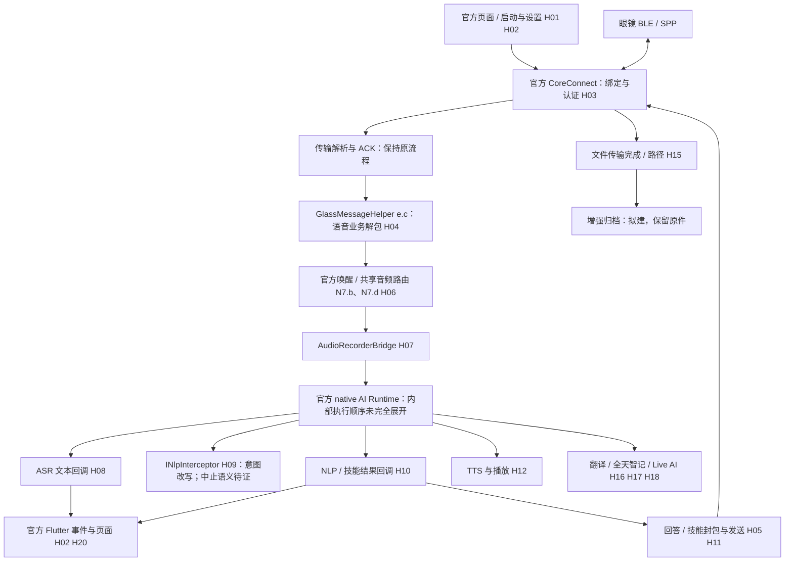
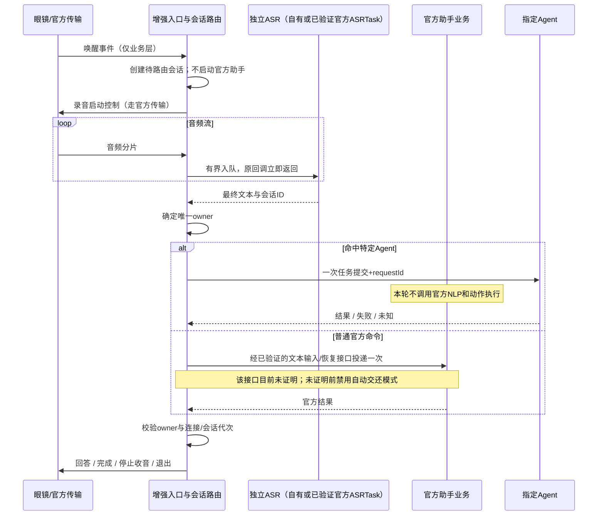

# Android 官方 App 增强：拦截点、会话路由与讨论方案

日期：2026-09-11。状态：静态调查与设计讨论；本轮不修改运行时代码、不构建安装增强 APK。

## 先回答：能否替换官方调用

可以把**已经定位、可以修改的本地业务调用**设计为可放行、观察、改写、短路或异步接管。这样可以让指定 Agent 独占一轮语音命令，官方原业务不再接收该轮输入。它不是“所有官方行为都可被任意替换”的保证：native 内部执行顺序、云端已开始的任务、眼镜端独立执行的动作，都不能靠拦截晚到的 Java 回调撤销。

之前的 V2 主要描述了数据旁路，未充分覆盖“单一处理者、命令独占和替换时机”，也没有先核实官方现成的 AI Runtime 扩展点，不能直接作为完整实施方案。本文件补齐这些前置决策。

| 动作 | 原处理是否执行 | 同步调用栈怎么走 | 适合用途 |
| --- | --- | --- | --- |
| PASS | 执行一次 | 直接调用原方法，保留返回/异常 | 默认官方行为 |
| OBSERVE | 执行一次 | 拷贝数据入自有有界队列，原方法继续；不等待消费者 | 日志、录音归档、状态观察 |
| TRANSFORM | 用改写后的参数执行一次 | 本地快速改写；遵守原接口契约 | 修改提示词、命令参数、展示文字 |
| CONSUME | 本点后面的原业务不调用 | 当场短路；必须返回真实且符合契约的结果 | Agent 会话阻止官方业务分发 |
| REPLACE_ASYNC | 不调用原业务，由增强层负责完成 | 保存自有上下文、快速返回；后台执行，经已定义回调/协议完成 | Agent、ASR、长任务 |
| DEFER | 暂未执行 | 将业务事件有界排队，原线程返回；之后最多投递给一个处理者 | 识别口令后再决定归属；须证明原流程可延迟恢复 |

这些是**拟建增强路由器的语义**，不是现有官方接口自带的全部能力。尤其一个只返回 boolean、没有后续 completion 的官方接口，不会因我们返回 true 就自然支持异步任务完成。

“阻塞”需要区分：

- **阻止业务继续执行**：需要支持，用入口闸门决定是否调用原逻辑。
- **挂住当前线程直到网络完成**：不用于 BLE/SPP、Flutter 主线程、native callback 或 `INlpInterceptor`。样本中的 `ShareHandler` 还有独立回调线程和 watchdog；等待 Agent 会拖住其他官方业务。
- **等结果后再继续业务**：用异步 continuation/事件状态机实现。原接口没有恢复入口时，不能假装支持 DEFER；需替换其上游调度，或者直接使用独占模式。

## 本次证据范围

| 证据 | 本次核实结果 | 能支持什么 |
| --- | --- | --- |
| 仓库最新远端 | `6e70122`，已在前一轮合并到本地 `45de234` | 1.0.2 的既往排障、进程/绑定/能力表问题 |
| 本机官方 APK | `RayNeo_AI_1.0.1.apk`，SHA-256 `9149fb0cf41c3007a7aea912657377cc06e719b4c893027087cf5d1097fb2510` | 本文具体类和处理分支的静态证据 |
| 本机 vendor DEX | 三份哈希仍匹配 1.0.1，不是文档所述的 1.0.2 | 不能把更新了源码版本号当成本地二进制同步 |
| jadx 1.5.5 | 处理约 12,246 类，最终报告 63 处反编译错误 | 可读方法可分析；失败方法改用 simple 指令视图，不把伪 Java 当可编译源码 |
| 本轮真机与 native/Flutter AOT | 未执行真机 hook；未完整逆向 `.so` 和 Dart AOT | 不能宣称 1.0.2 的补丁、所有固件或云端兼容性已通过 |

标记规则：**A**=本轮在 1.0.1 可读代码中定位；**B**=simple 指令视图/跨文件静态链，需 Smali 和真机复核；**C**=接口/通道已发现但业务触发或语义未证；**U**=未定位。A 也不代表 hook 已实现或通过真机测试。

以下是当前调查覆盖面的完整点位台账，包含不可承诺的点。它不是对未分析 native/云端/固件中“所有可能点位”的穷尽声明。

## 已发现的实际调用结构

这张图表示已见接口关系，不把 ASR 回调画成“官方 NLP 必须等待它返回”的串行关卡。`INlpInterceptor` 与 ASR、模型请求的精确先后，仍需 native/真机时序证明。

## 点位台账

表中“可设计动作”只描述在该位置增加补丁后的控制范围；未实现项不会因列入表格变成现成功能。

| ID | 点位与静态锚点 | 可取得/控制的内容 | 可设计动作与限制 | 证据 |
| --- | --- | --- | --- | --- |
| H01 | `VenusApplication.onCreate`；官方插件 `j` 生命周期 | 增强初始化、进程识别、官方插件就绪和重建 | 附着、开关、故障停用；不替换官方启动，也不覆盖插件 Activity 引用 | A |
| H02 | 插件 `j.r(...)` MethodChannel 入口、`j.z(String,Map)` EventChannel 出口 | Flutter 发起的设备调用及 native 返回事件 | 观察/按已识别方法拦截；`r` 大方法仍需逐分支复核；不能吞所有事件 | A/B |
| H03 | CoreConnect `I3.v`（jadx `I3.C0837v`）、`T3.g`、插件 `j$e` | 设备连接/断线/绑定、能力就绪线索、连接代次 | 只观察和复用官方状态；不伪造认证成功，不把系统 GATT 当本进程就绪 | A + 1.0.2 记录 |
| **H04** | `com.rayneo.rayneo_venus_sdk_plugin.e.c(String,byte[])`（GlassMessageHelper） | type 1 唤醒、3 音频、8 退出、11 下一轮、13 技能结果、161–168 全天智记相关 | **在原监听器分发前按设备/会话/子类型短路或接管**；这是独占语音候选主入口，禁止整段丢弃 business 13 | A |
| **H05** | `I3.v.t(P)` / `u(P,Function2)`；`e.j/e.l` 回答封包；`K7.c` 输出路径 | 手机→眼镜的助手控制、回答、技能指令；发送回调 | 出口归属检查、改写、拒绝旧会话输出；只过滤目标业务，保留连接/ACK/其他功能。覆盖所有发送路径尚待证明 | A/B |
| H06 | `N7.b` 官方消息处理器、`N7.d` sharedAudioRouter、`G7.E` AudioPriorityArbitrator | 唤醒、音源、助手/翻译/全天智记的音频优先级、系统打断 | 接入音频归属和暂停/恢复；不能独立抢麦后遗留官方 active 状态 | A/B |
| **H07** | `AudioRecorderBridge.AudioRecorderAdapter.notifyRecordData*`、`G7.X0`、`G7.g`（jadx `C0724g`） | 进入 native 前的音频字节及部分 VPU/VAD 元数据、启停 | 复制音频或选择音频消费者；必须区分 workModule、手机麦克风与眼镜输入，验证每条路径编码 | A |
| **H08** | `AssistantController.nativeOnAsrResult` → `AiResultListener` → `K7.c$c.onAsrResult`；另有 `ASRController/ASRTask` | 识别文本、final、sid；官方继续发 Flutter 事件和 ASR 显示包 | 可观察/改写下游文字；**不能证明在此拦截能阻止 native NLP 或云请求** | A |
| **H09** | `AssistantController.setNlpInterceptor`、`INlpInterceptor.intercept`、现有 `G7.M0` | `NlpResult.query/domain/intent/command/answer` 等 | 可改写意图；布尔值写入 `response.intercepted`。现有 true 分支仍在修正官方行为，**不能等同于 CONSUME**；单槽，需组合保留原拦截器 | A，终止语义 C |
| **H10** | `K7.c$c.onNlpResult` | NLP 结果、commandName/params/requestId、Flutter `onNlpResult` 与 `onIntentRaised`，以及技能封包 | 替换本地后续动作需在所有分支之前接管；仅禁 Flutter 或镜片输出无法撤销已执行的 native/云动作 | B |
| H11 | `AssistantController.sendCommandResult(NlpCommandResult)`；`e.c` type 13；`N7.b$b.i(...)` | 眼镜技能执行结果回传和 requestId 关联 | 用于真实命令闭环；不为拦截的官方命令伪造成功。Agent 的任务状态与官方技能回执分开 | A/B |
| H12 | `TTSController/TTSTask`、`TTSCallbackBridge`、`AudioPlayerBridge.AudioPlayerAdapter` | 合成任务、音频播放、开始/完成 | 观察、替换已识别播放流、仲裁发声；静音官方 TTS 只解决重复声音，不解决重复执行 | A/C |
| H13 | `AssistantController.start/pause/resume/stopWorkflow/startNextRound`；`K7.c` start/stop 封装 | 官方助手生命周期、uuid listenerMap | 按官方封装协调会话；不能仅调 native stop 而漏掉音频归属和 Flutter 状态清理 | A/B |
| H14 | `I3.v.q/l`、`u(P,Function2)`、`I3.S.a` ACK 分支 | SDK 发送成功/错误、消息关联 | 观察回执、超时分类；SDK ACK 不等于镜片展示。`t` 会清空 per-message callback，需正确选择入口 | A/B |
| H15 | `I3.v.r(...)` → `j.z("fileShareSuccess",...)`；`v(File,...)` | 文件任务、role、fileName、filePath、进度、失败 | 完成后复制并校验录音/文件；不修改原传输和原文件。普通录音是否都走此口、容器格式仍待真机确认 | A/C |
| H16 | `TranslateController`、`TranslateResultListener`；字幕业务 19 | 翻译文本、语言/角色、VAD/起止，字幕输出 | 观察与按翻译会话替换；需保留共享音频优先级，不能用语音助手规则全局覆盖 | A/C |
| H17 | `AlwaysOnController/ResultListener`；H04 的 161–168 分支 | 全天智记音频片段、任务和缓冲/退出状态 | 可调查归档或处理器替换；不等同普通录音，也不承诺全天后台可靠性 | A/C |
| H18 | `LiveAiController`、`CameraBridge` 的 VQA/预览回调 | Live AI、图像 URL/字节、预览帧候选接口 | 可观察/替换接口调用；**类存在不证明用户这副眼镜支持摄像头或该功能** | C |
| H19 | `ASRTask`、`AskAITask`、`AiAgentConfig`、模型/服务配置对象 | 独立 ASR 任务、AskAI 输入输出、配置入口 | 优先研究“只复用官方 ASR”再接自有 Agent；不能仅改 URL 就视作任意模型协议兼容 | A/C |
| H20 | 官方 ASR/NLP/文件 EventChannel；官方 Flutter AOT `libapp.so` | 官方页面状态、历史展示、业务页面 | 原页面保留；新增原生增强页可行。官方页面深度定制和内部路由仍需 AOT 分析，不是替换 XML 即可 | A/U |
| H21 | 业务 21 通知、20 提词、22 待办、15 Launcher、32 导航 | 自定义内容、功能入口、状态回报的候选通道 | 通道级发送/接收可研究；每种 payload、双向状态同步及硬件表现需逐项验证 | A（通道）/C（能力） |
| H22 | 官方 SharedPreferences/数据库/最终文件；历史云 API | 绑定记录、录音索引、历史数据 | 本轮只确认绑定记录的既往证据和文件回调；历史 schema/加密/API 未定位，不能承诺全部历史可导出 | C/U |
| H23 | `NetworkBridge`、`RayNeoServerConfig`、Dart/native 网络层 | 网络可用性、服务配置；模型/云调用待追踪 | `NetworkBridge` 仅报告网络可用性，**不是 HTTP 请求拦截器**。全局断网会破坏官方功能，不用作 Agent 路由 | A/U |
| H24 | Manifest、官方启动/后台组件、认证/签名依赖、OTA/固件 | 启动入口、后台生命周期、兼容性边界 | 最小打包注入；不绕过认证/固件保护。重签兼容性需先回归；App 补丁不能任意修改固件和云端行为 | A/C/U |

### 业务通道覆盖面

1.0.1 `S3.h` 的枚举提供以下通道标识；这是协议分类证据，不是这些功能全部可用的证明。数值取构造函数 byte 字段，不能用枚举 ordinal：19 以后已有不连续编号。

| ID | 枚举名称 | 调查定位 |
| --- | --- | --- |
| 0 | RESERVED | 默认/未知映射；发送未知业务必须拒绝，不能靠枚举非 null 判断支持 |
| 1–7 | APP_MARKET / SHORTCUTS / GYRO_CALIBRATION / WHISPER_MODE / SCREEN_LOCK_TIME / VERSION_CHECK / ACTION_BUTTON_CUSTOM | 商店、快捷操作、校准与设置；仅定位通道，语义未逐项解析 |
| 8–12 | MARS_STREAMING / MARS_FOTA / MARS_PHOTO_TRANSFER / LOG_REPORT / HEARTBEAT | 硬件型号相关媒体、升级、日志与心跳；保留原流程 |
| 13 | VOICE_ASSISTANT | 本次重点；内部还包含全天智记消息，不能全拦 |
| 14 | RECORDING_SERVICE | 普通录音业务；与录音文件传输区分 |
| 15 | LAUNCHER | 菜单/入口 |
| 16 | CONNECTION_PAIRING | 保留官方绑定与认证 |
| 17 / 18 | FILE_TRANSFER / FILE_TRANSFER_LAUNCHER | 文件通道；传输与业务结果分开 |
| 19 / 20 / 21 / 22 | AI_SUBTITLE / TELEPROMPTER / NOTIFICATION / SCHEDULE_TODO | 字幕、提词、通知、待办 |
| 23 / 24 / 25 / 32 | PROACTIVE_AI / AI_WIDGET / NETWORK_FORWARD / NAVIGATION | 主动 AI、组件、网络转发、导航；需后续逐功能审计 |

## 三种语音接管方案：需要讨论的实质差别

| 方案 | 输入如何分流 | 官方会处理到哪一步 | 优点 | 关键缺口 |
| --- | --- | --- | --- | --- |
| **A：显式 Agent 模式，入口独占** | 用户预先选 Agent；H04 在官方唤醒/音频分发前决定归属 | 只复用连接/传输；Agent 轮不进官方助手 | 最容易证明没有两套助手同时执行；无需等官方先理解命令 | 增强层须补齐录音控制、ASR、会话退出；硬件唤醒可区分性未证，不能承诺自定义唤醒词 |
| **B：一次 ASR，文本路由** | 统一收音→独立 ASR→识别“交给某 Agent”→只交给一方 | 普通命令经可恢复入口交还官方；Agent 命令不进官方 NLP | 最接近日常自然口令分流，同时只做一次识别 | 必须验证官方存在完整文本输入/会话恢复接口；当前 `sendAsr` 是发给眼镜的显示协议，不能充当官方 NLP 文本输入 |
| **C：复用官方整条识别链，在 NLP/动作阶段接管** | H08/H09/H10 匹配命令 | 官方 ASR 已执行；官方 NLU/模型可能也已执行 | 可最大程度复用现成业务，改动可能较小 | 不一定满足“官方完全不处理 Agent 命令”；需证明拦截早于本地/眼镜/云端副作用，不能靠隐藏回答验收 |

推荐把 **B 作为自然口令体验的目标，A 作为优先验证和可回退的独占基线**。C 只有在用户接受官方先做识别/语义分析，且证明动作未先执行时才合适。

例如“交给 Codex，检查这个项目的测试”：A 在收音前就选 Codex，本轮全给增强语音链；B 识别完前缀后选择 Codex；C 可能等官方已经生成“我无法处理”后才截获，这不符合目标体验，也可能已有副作用。

不能同时宣称“等官方识别出文本以后再决定”与“官方从未接触过该语音”。如果要求 Agent 语音不上传官方服务，必须采用 A，或自有/已验证独立识别的 B。

## 避免双重处理的完整契约

只在输出端拦一句话不够。至少需要以下互相配合的控制点：

1. **入口闸门 H04/H06**：在启动官方助手、投递音频和下一轮事件前选择唯一 owner。按设备、连接代次、会话、轮次和子业务匹配；普通录音、翻译、心跳、绑定及系统退出继续原流程。
2. **命令执行闸门 H10/H19**：如果采用语义分流，在所有本地命令分支、Flutter `onIntentRaised`、技能下发、云任务提交之前确定归属。不存在共同且足够早的闸门时，不启用该模式。
3. **输出闸门 H05/H12**：官方文本、TTS、技能指令和 Agent 回答都检查 owner；阻止旧会话迟到的回答覆盖新会话。此层是补充防线，不是避免重复执行的唯一手段。
4. **回执与恢复 H11/H13/H14**：在真实完成、失败、未知、退出或断线后结束当前轮。恢复原有音频优先级、页面与下一轮入口，不能只重新放行字节而留一个脏状态机。

拟建会话上下文：`deviceId + connectionEpoch + sessionId + turnId + owner + requestId + phase`。线程间通过一个串行状态机更新；官方没有匹配 ID 的回调按已验证的绑定规则关联，无法可靠关联时不能发送到新会话。

`requestId` 只解决本地重复提交的一部分。Agent 端需支持幂等/状态查询才可实现跨重试去重；不支持时采用提交一次、断网记 Unknown，不自动重发，不声称网络意义上的 exactly-once。

**失败策略按阶段区分**：尚未取得会话的兼容性故障，可以保持官方原流程；已经消费/提交 Agent 命令之后，不自动把同一句转发官方。必要时提示失败或结果未知，让用户主动重新发起，避免第二次执行。

## 图示与具体时序

- [独占路由流程图](diagrams/voice-routing-v3.html)：方案 A 的业务归属与输出控制。
- [Agent 命令时序图](diagrams/agent-exclusive-v3.html)：方案 A 的同步短路与异步处理。
- 图中 H04/H05 是拟加补丁与路由语义；现有方法没有天然实现这些闸门。

下面补充方案 B 的时序，标明尚未证明的恢复入口；它不能作为当前实现说明：

取消/插话：提升 turn/epoch，发出当前协议支持的取消/停止请求，旧任务即便无法远端取消也不再拥有输出权。连接丢失时不声称眼镜已停止；重连后重新核实状态。

## 进一步验证什么，才进入实现

| 验证 | 实验与证据 | 通过条件 |
| --- | --- | --- |
| 样本一致性 | 取得并核验 1.0.2 原 APK，重新定位 H04–H14 及 raw DEX 方法签名 | 目标版本的字节码与补丁目标匹配；不能拿 jadx 重命名类直接反射 |
| 官方功能保留 | 无增强重签基线与原版逐项对照；登录、绑定、语音、录音、翻译、通知、后台等 | 所有实际需要功能通过；未测项继续标注，签名不兼容则停路线 |
| H04 是否足够早 | 记录唤醒、分发、workflow start、首音频、首模型请求的单调时钟顺序 | Agent 轮官方助手启动/模型请求/动作计数为零；仅保留传输活动 |
| H09 true 的真实作用 | 在隔离测试会话对照 false/true/原拦截器；检查 native、Flutter、技能下发和网络 | 明确是改写、停止自动处理还是仅改变后续状态；未证前不用作唯一拦截 |
| B 的普通命令恢复 | 独立 ASR 文本经候选入口发起官方完整一轮，覆盖多轮、取消、设备命令 | 语义和原语音一致；无法证明则保留 A，不用显示用 type 5 冒充输入 |
| 全路径去重 | 一句命令统计官方动作、Agent 提交、技能下发、TTS 与输出 | 正确 owner 至多提交一次；观察消费者不算第二次执行 |
| 故障隔离与恢复 | 断线、超时、识别失败、队列溢出、进程重启、迟到回执、退出/系统打断 | 不自动双投、不复用旧会话、不永久占用录音；能重新使用官方功能 |
| 非语音回归 | 普通录音、翻译、全天智记、通知、绑定/心跳等分别测试 | H04 按子业务精准匹配，不误吞同 business 通道中的其他功能 |

此阶段的交付应该是“点位命中与调用顺序证据 + 可行性结论”，不是先写一个新控制台或承诺已支持全部协议。

## 静态定位索引（便于复核）

反编译结果仅位于本机 `/private/tmp/rayneo-101-audit`，不加入仓库；这里记录类/方法与行号，不分发厂商源码。jadx 对大小写冲突进行了重命名，括号外为原始包内类名，实施前仍需以 DEX/Smali 为准。

| 索引 | 文件 / 行位置 | 本次实际阅读内容 |
| --- | --- | --- |
| E01 | `com/rayneo/rayneo_venus_sdk_plugin/e.java:571` | `c` 解包；约 604–692 唤醒、音频、退出、下一轮；type 13 技能结果 |
| E02 | `N7/b.java:111`；`N7/d.java:323` | 具体监听器类型、共享音频和官方会话控制依赖；部分处理方法需 simple/Smali 继续展开 |
| E03 | `com/rayneo/airuntime/bridge/AudioRecorderBridge.java:32,119,188` | 音频入 native、按 module adapter、init 会 release 原 adapter |
| E04 | `com/rayneo/airuntime/controller/AssistantController.java:48,269,312,343` | ASR callback、native interceptor、workflow listener/生命周期 |
| E05 | `K7/c.java:248,861` | 官方 ASR listener 与现有拦截器注册；本机 simple 输出 `rayneo-assistant-simple.java:445` 展开 NLP 后续分支 |
| E06 | `G7/M0.java:27`；`INlpInterceptor.java:10` | 现有拦截器修改 intent/domain/hasNextRound；布尔写回 intercepted |
| E07 | `I3/v`（`I3/C0837v.java:525,633,659,685`） | 消息错误/成功、文件完成、t/u 发送；消息 delegate 强转官方具体类 |
| E08 | `com/rayneo/rayneo_venus_sdk_plugin/j.java:1474`；`G7/A1.java` | EventChannel 出口及缓冲，不能抢占消费 |
| E09 | `I3/S` 本机 simple 输出 `rayneo-dispatch-simple.java:25` | 先处理 ACK/连接配对再走业务通知；业务闸门不能提前吞掉传输处理 |
| E10 | `S3/h`（`S3/EnumC1038h.java:85`） | 业务编号 byte 字段、保留值与未知 fallback |
| E11 | `ASRTask.java:220`；`AskAITask.java:69`；`AudioPlayerBridge.java:44` | ASR 独立任务、AskAI 启动、播放音频适配 |
| E12 | `CameraBridge.java:16`；`NetworkBridge.java:21`；`ShareHandler.java:53` | 图像能力候选、网络可用性而非 HTTP、native callback 专用线程 |

## 讨论结论

本次不定稿某个未经验证的 hook 实现。先共同确认三个产品约束：是否允许官方只做 ASR；是否要求自动按口令分流而无需预选模式；首批需要开放的非语音能力。它们决定选择 A/B/C 及验证优先级。

在这些约束明确和目标版本链路验证之前，停止扩写运行时代码。保留完整官方 App 是产品目标，按会话精准替换是增强机制，二者必须一起验收。
