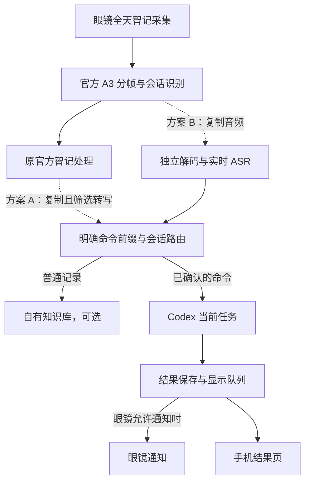
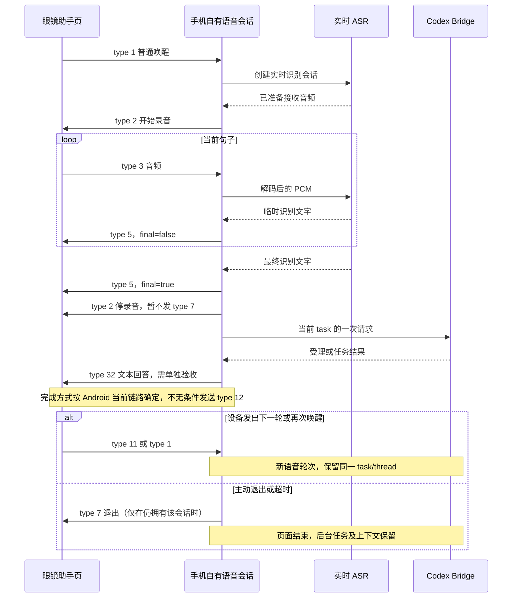

# 眼镜语音下一阶段方案

## 结论与范围

分析底座为 Android RayNeo AI 1.0.2（68），原包 SHA-256 为 `32c67abbdf3c87eb113f965f984b79eee17b4bf3136f14f535375752ab1a7093`。Android 仓库 HEAD 为 `45de234`，分析包含当前未提交的 Demo；Turbo-IO 参考 HEAD 为 `7e885ba`。调研时间为 2026-09-11。

当前真机证据已经推进到：普通唤醒、眼镜音频输入、MiniMax ASR、手机识别正文、眼镜普通通知均得到使用者确认。此前全天智记占用时，Demo 在发出录音 START 前拒绝了唤醒。尚未验证自有实时字幕、助手回答卡片、手动下一轮、自有智记、智记期间通知显示，以及完整官方功能回归。

| 需求 | 结论 | 推荐做法 | 不纳入当前承诺的能力 |
|---|---|---|---|
| 全天智记与自有 Agent 共存 | 可以设计为共享已存在的数据；普通助手与智记并行开启两套采集没有可复用的官方支持证据 | 保留官方智记采集，复制音频或经过语义确认的转写，在手机路由命令 | 无损自动暂停恢复、智记和助手两种眼镜页面同时保持 |
| 自己实现全天智记 | 实时采集协议和原始音频入口存在，可实现独立采集、ASR、存储和检索 | 独立立项处理 A1–A8 生命周期，先做在线短时版本 | 全天续航、离线完整补传、官方云端历史和页面原位兼容 |
| 基于回答继续提问 | 可以实现，关键是任务上下文与下一轮语音路由 | 再次唤醒继续当前任务；后续升级助手页内下一轮 | 仅把通知的 `reply` 改为 true 就获得语音回复 |
| 边说边显示 ASR | 官方具有明确文本输出协议；需要实时 ASR 与页面生命周期改造 | 实时音频 ASR → type 5 临时/最终文字；说完只停录音，不立即退出页面 | 当前文件 ASR 仅改 `stream=true` 就实现边说边识别；自有页面完全等同官方的像素与交互 |

“可以实现”在本文表示输入、处理和输出链路已有明确实现路径，不表示对应新增能力已在这副眼镜上验收。官方手机代码能证明发送行为和事件入口，不能代替眼镜固件显示和硬件调度的实测。

## 一、全天智记的共存边界

### 1. 普通唤醒为什么冲突

官方 `G7.E.a()` 的普通助手仲裁结果在 `alwaysOnActive=true` 时携带 `stopAlwaysOn=true`。`N7.d.a(decision, requester)` 执行这个停止动作后才允许继续。`N7.b` 的普通唤醒会经过这条链。[S1][S2]

因此，当前 Demo 的忙碌拒绝是保守的资源保护，不是已证明硬件永远不能复用音频；但直接删除拒绝也不构成共存实现。官方原流程已经明确选择停止智记，新增逻辑必须重新定义数据所有权和退出行为。

**停止和暂停不是一回事。** 本次确认了 stopAlwaysOn 调用，没有建立可无损恢复原 task、缓存、云端 workflow 的暂停/继续契约。将其停止后重新启动不能承诺没有漏录或记录切段。

### 2. 共享音频入口确实存在，但没有智记模式

官方 `WakeBean` 接收 `rc/mode/linkType`。`rc=7` 被路由为 `SHARED_AUDIO`，`m` 枚举的有效模式只有 RECORDING=1、CAPTION=2、TELEPROMPTER=3。共享唤醒还会检查来源业务是否处于 active 状态。[S2][S3]

这里的 RECORDING 不能按中文名称直接解释为“全天智记”：它与独立的 AlwaysOn 管理器、A3/A4 音频路径是分开的。当前不能把 `rc=7, mode=1` 当作已支持全天智记共存的入口，也不能通过伪造 active 状态把它变成安全方案。

另一个容易漏掉的分支：普通 type 3 音频在 owner 为 `ALWAYS_ON` 时，也会被交给智记管理器。因此路由必须同时检查 owner 和会话，不能只看消息类型。[S2]

### 3. 可实现的共存方式：保留一条采集，在手机复制数据

**方案 A：复制智记文字。** `I7.h.b.onAlwaysOnResponse` 已暴露 `taskId、role、text、roundId、finished`。新增观察逻辑复制数据后立即返回，官方继续收到原始回调，自己的存储和 Agent 路由在独立队列处理。[S4]

这个入口足以建立结构化文本副本。但 `role` 是回调字段，不能仅凭字段名就断言每条 text 都是佩戴者的原话。实现前必须确定实际角色取值及原始转写、摘要/生成内容的区分；只有已确定的语音转写事件可以作为命令候选，不能拿任意 AI 生成文字触发 Codex。该方案还保留了官方 ASR/云端处理，不能满足“语音完全不经过官方服务”。

**方案 B：复制智记音频，使用自己的 ASR。** 在 A3 实时帧解析后、进入官方处理之前复制音频，官方原路径不变；自己的解码器与实时 ASR 处理副本。官方 1.0.2 的 `e.g()` 已处理新旧 A3 格式：新格式按 240 字节拆帧，结合 `frameCount、vpuMask、vadMask、mode、taskId`，并收敛无效帧数。不能把整个 A3 数据包当成一个普通 type 3 Opus 帧。`I7.h.f()` 将分帧音频及 VPU/VAD 信息交给 native；智记默认输入配置为 Opus。[S5]

方案 B 不启动第二条眼镜录音链路、不发送普通助手 START/STOP、不停止官方智记。副本必须有独立缓冲区、有界队列与背压；自有服务变慢时不能阻塞官方音频线程。开启此方案意味着同一音频也被自己的 ASR 处理，增加网络与算力开销，不承诺续航不变。

智记期间的可用交互设计是：开启“智记命令路由”后，直接说“Codex，新任务，检查构建失败原因”，由持续转写中的明确前缀触发；后续说“Codex，继续刚才的任务……”。这里的“Codex”是手机收到转写后的文本规则，不是修改眼镜固件唤醒词。普通闲聊仍只进入智记，不交给 Agent。

仅凭前缀也不能可靠认定说话人身份；录入的其他人声音、复述命令或设备播报不能自动获得操作授权。首版宜采用明确启用的命令窗口或佩戴者确认机制，保留 Codex 自身的操作审批边界；VPU/VAD 标志不当作身份认证。

**音频数据共存与眼镜界面共存分别验收。** 正常状态下通知已实测显示，但智记运行中能否弹出通知、能否覆盖实时智记页，尚未实测。Turbo-IO 的通知状态处理还区分未佩戴、免打扰和其他功能占用，发送回调不能回答这些显示问题。[S6] 如果前台显示受限，自有结果保存在手机，等允许显示时提醒，不能承诺即时弹窗。



图中 A、B 是两种输入选择，不需要同时部署；两者均不通过“再唤醒普通助手”获取第二份音频。

### 4. 自有全天智记需要实现什么

1. **采集控制。** 接管自有智记会话的 A1 唤醒、A2 开始、A3 实时音频、A4 缓存音频、A5 退出、A6 异常、A7 缓存查询、A8 实时页面状态。消息名称与方向在官方代码中存在；完整时序和设备响应须逐项验收。[S5]
2. **可靠存储。** 分别处理实时流与缓存流，维护 task、片段标识、顺序和结束状态；断线重连后进行去重及缺口标记。A4 存在不等于任意断线期间都能无损补回，也不应承诺设备缓存容量无限。
3. **语音到知识。** 自有 ASR 产生可修订转写，最终结果写入事件存储；再生成摘要、检索索引、任务抽取。原始记录与模型生成摘要分开保存，摘要不能覆盖原记录。
4. **应用与资源。** 处理 Android 后台生命周期、连接恢复、通话/翻译抢占、缓存上限、取消、网络失败，以及耗电与温升。先证明几十分钟稳定，再扩大时长，不能由一分钟 PoC 外推全天可靠性。
5. **产品边界。** 自有历史、搜索、摘要展示先放在增强页。未提供官方云端写入与页面模型的完整兼容实现前，不承诺自有记录自动出现在官方智记历史中。

如果开启自有智记取代官方智记，两套智记不能同时拥有设备控制权。关闭自有模式要清理自有会话并恢复官方入口；“关闭后原功能仍可使用”不等于“自有期间所有记录也由官方保存”。

**推荐顺序：先做复制与路由，后做全替换。** 这能将 Agent 交互需求与全天采集可靠性拆开验收。

## 二、回复一条消息与继续一个任务

### 1. 现有通知为什么无法继续

Demo 的普通通知使用 business 21/type 2，明确发送 `reply=false`，只有标题、正文和 notificationUID，没有绑定 Codex task/thread。控制器还明确忽略助手 type 11 下一轮。ASR 后只是回显文字，并没有创建真实 Codex 会话。[S7]

Turbo-IO 的通知模块同样使用 `reply=false`。它接收同 UID 的 type 3 状态以及 type 4 `cmd` 操作，但代码明确没有把 cmd 当成已验证的工具执行或语音回复入口。[S6]

因此，**在通知卡片上直接点“回复”并继续录音，这条能力目前不能作为可交付方案。** 仅存在 `reply` 字段，不能证明开启按钮、采集回复、收到文本、绑定上下文四个步骤已经成立；需恢复 Android 通知业务和眼镜回报的完整契约，才能决定是否实现。

### 2. 已有路径最明确的做法：重新唤醒，继续当前任务

手机持久保存 `currentTaskId → threadId`，每次最终 ASR 生成新的唯一请求 ID。第一次创建任务；后续默认继续当前任务；“新任务”明确新建，不能每次唤醒都重建 thread。通知 UID 可关联 task，但收到后台通知不自动切换当前任务。

Turbo-IO 的 `codex-bridge/bridge.mjs` 已有直接证据：带 taskId 的 message 调用 `thread/resume`，不带则 `thread/start`；之后在该 thread 上发 `turn/start`，并维护幂等请求表。当前 bridge 在任务运行或等待审批时拒绝追加消息，因此“继续追问”先定义为上一轮结束后追加；运行中追问需要显式排队，或者完成停止后再提交，不能宣称现有 bridge 已支持即时打断式 steer。[S8]

拟实现体验：

| 动作 | 行为 |
|---|---|
| 唤醒并说“新任务，检查构建失败” | 创建当前任务，保存对应 thread |
| 收到“检查完成：缺少依赖”的通知 | 通知绑定原任务，任务结果保存在手机/bridge |
| 再次唤醒，说“那应该怎么修？” | 在同一个 thread 提问，保留前文 |
| 说“新任务，看看另一个问题” | 新建 thread，并明确切换当前任务 |

这种追问不依赖通知卡片可点击。当前普通唤醒仍受智记占用约束；需要同时保留智记时，改用上一节的持续转写命令入口。

### 3. 更接近官方的做法：助手页展示回答并接下一轮

官方 `e.c()` 收到 type 11 后，调用 `N7.b` 的下一轮处理，再进入官方 AIRuntime 的 `startNextRound`。自有模式应接住此事件，让自己的 ASR 开始新一轮，继续同一个 task；不能直接调用官方 startNextRound，否则会启动官方业务逻辑。[S9]

回答不能放到 ASR 文本字段里冒充输入。官方 `e.l()` 将 `SkillPayloadTransportPayload` 发为 type 32，包含 `answer.text/isFinal` 及会话、query、domain、intent 等；type 5 则是识别文字。[S10]

方案为：唤醒 → ASR 字幕 → 停止本轮录音但保留助手页 → 显示任务受理或回答 → 用户触发设备现有下一轮事件，或者再次唤醒。具体按键、手势及是否会在这副固件上产生 type 11，还需验证，不能从手机接收分支反推物理操作。

耗时任务不长期占用眼镜助手页：先显示已提交，允许退出，完成后走通知；任务上下文由手机/bridge 持有，眼镜页面退出不删除任务。

## 三、实时 ASR 字幕与助手页面保留

### 1. 页面消失的直接原因

`DemoController.finishCapture()` 调用 `closeDevice()`；后者发送 type 2/rc 2 停录音和 type 7/rc 1 退出助手，两个发送回调结束后才调用 `startAsr()`。所以“说完 → 助手消失 → 通知弹出”是当前 Demo 写出的顺序。[S7]

下一版必须把录音、显示、任务三个生命周期分开。说完只结束当前音频轮次，页面保留用于显示最终转写和回答；只有明确退出、超时、断连或更高优先级业务抢占，才结束展示会话。仅删掉退出命令仍不够，还需处理设备退出事件、超时和新轮次，避免卡在等待状态。

### 2. 官方已有临时/最终文本显示协议

`K7.c.C0062c.onAsrResult(asr, finished, sid)` 使用 `AsrTextTransportPayload` 发出 type 5；其字段注解将 `isFinal` 序列化为 `final`。[S10]

```json
{"text":"帮我检查这个项目","final":false}
```

随后最终结果发送 `final=true`。来自 ASR 的临时修订用于刷新当前句，而不是每个 partial 都创建一个 Codex 请求；只有最终句提交一次。发送前校验会话代际、文本长度并合并过快更新，最终结果不丢弃。具体更新频率与可显示长度用真机测试确定，不能将 iOS 原型的限制值当成 Android 固件规格。

**现阶段可以确定编码与官方调用入口；尚不能承诺自有会话的镜片排版、动画、自动翻页与官方完全一致。** 这些由眼镜页面状态和固件决定。

### 3. 当前 MiniMax 接口为何不足

本次读取了指定的 MiniMax 官方 ASR 文档：请求是 multipart 文件上传；文件最长 500 秒、最大 50 MB，不接受无容器裸 PCM。`stream=true` 控制 SSE 增量文本输出，事件包含 index/delta/finish。[S11]

当前 Demo 在完整 WAV 收集完毕后才发 HTTP 请求，并设置 `stream=false`。即使改为 true，音频输入仍然是先完成的文件；文档没有提供本接口在一个实时会话中持续接收后续麦克风帧的契约。因此它适合录音后转写、分段智记或回退识别，不是本方案已确认可用的双向实时 ASR。

把短录音反复切片调用文件接口可以产生分段结果，但不能当作完整连续流式 ASR：会引入切词、上下文拼接、重复请求和更复杂的延迟/计费。它不作为首选的“官方一样边说边显示”实现。

### 4. 实时服务选择与资源

可以接入明确支持音频流输入和中间文本输出的 ASR。阿里云 Fun-ASR-Realtime 的官方协议提供 WebSocket 双向流：run-task → task-started → 二进制音频 → result-generated → finish-task。结果用 sentence_end 区分中间与句末；PCM 是明确支持的输入格式。它的 Opus 要求 Ogg 容器，不能把眼镜裸 Opus 包直接当作该格式上传。[S12]

推荐的适配层输入是已经解码的 16 kHz、单声道 PCM，输出统一为 `partial/final/error` 及轮次标识。后端服务可以替换，眼镜 presenter 不依赖具体厂商事件格式。选此服务需要对应地域的服务权限、API Key 与网络连接；本轮没有调用该付费服务，也没有测量其在当前手机网络上的延迟。

官方包还有独立 `ASRController/ASRTask`，具备 ASR 回调和任务入口；但 JNI 内部实现、会话资源和服务鉴权仍由官方管理。类存在不等于可安全新增任意并发实例，因此它作为后续复用候选，不作为当前独立 Agent 的首选依赖。[S13]

### 5. Android 与 iOS 必须分别处理回答结束

Turbo-IO 的 `StandbyVoiceSession` 已实现 type 5 转写、type 32 回答、type 12 完成，以及实验性的连续收音状态机；回答编码器仍注明没有镜片验证，不能把它当成 Android 已验证能力。[S14]

Android 1.0.2 有两个重要差异：

- 官方 `onResponseComplete()` 仅在 `LinkType.RAYCLAW` 时发送 type 12，其他链路明确跳过。因此不能把 iOS 的“所有回答都 type 12 完成”直接搬过来，也不应为此全局改官方 linkType。
- Android 的 type 32 构造从原 NlpResult 取 finished，timestamp 使用 `currentTimeMillis()/1000`；参考 iOS 原型的时间戳接口为毫秒，并有自己观测到的 answer-final 策略。应以 Android 原始构造和当前设备链路为准，不照抄 iOS 的 vendor、UUID、时间单位或结束标志。[S10][S14]

因此实时字幕可以先独立验收，回答卡片随后验收，页面内连续收音再单独验收。三者不是必须一次成功的同一个改动。



此图描述拟实现的普通语音交互，不表示它可同时启动官方全天智记；共存输入使用第一节的音频/文本复制路径。

## 四、建议讨论和验收顺序

1. **先选交互主线。** 推荐“普通助手页内实时字幕 + 再次唤醒继续当前任务”；后台完成仍用已经实测通过的通知。它直接解决当前反馈的两个交互缺口。
2. **先验证页面再接 Agent。** 用明确的测试文字验证 type 5 临时/最终更新、只停录音保留页面、退出和抢占；再接实时 ASR。这样能区分 ASR 延迟与固件展示问题。
3. **补上下文和回答。** 使用桥接的 task/thread 关联、请求幂等与任务状态；验证 type 32 回答及对应结束方式。type 11 手动下一轮作为独立验收项，不能以通知发送成功替代。
4. **智记共存作为第二条输入。** 先复制少量结构化转写确认其语义；需要自有识别时复制 A3 音频。验证官方仍完整收到数据、任务不被终止、自有队列堵塞不拖慢官方、眼镜能否在智记中提示。
5. **最后决定全自建智记。** 只有明确需要替换官方转写/知识存储，才承担 A1–A8、缓存与全天运行的完整维护成本。

关闭模式时应继续满足：不截走原官方事件、不发送新自有字幕或通知、不启动第二个官方引擎、不修改官方通知开关和模型配置。已提交的通知及已启动的电脑任务需要各自明确生命周期；不能用一个模式开关隐式撤销所有后台行为。

本轮只增加本文档；不修改应用代码、不打包、不安装、不更改眼镜设置。下一轮实现范围须在讨论后确定。

## 来源与证据索引

以下本地官方源码均由固定 1.0.2 APK 反编译取得，是私有审计材料，不是厂商公开 SDK 文档。涉及反编译不完整的方法，按相同 APK 的 Smali 核对；文件中的 JADX 异常占位不代表原 APK 在运行时抛出该异常。

- **S1**：[G7.E 仲裁](/Users/USER/opensource/rayneo-local-samples/audit-1.0.2/sources/G7/E.java:39)；[N7.d 停止业务](/Users/USER/opensource/rayneo-local-samples/audit-1.0.2/sources/N7/d.java:366)。原始 [G7.E Smali](/Users/USER/opensource/Unofficial-IO-Android/enhancer/build/decoded/smali_classes2/G7/E.smali:71)、[N7.d Smali](/Users/USER/opensource/Unofficial-IO-Android/enhancer/build/decoded/smali_classes2/N7/d.smali:347)。
- **S2**：[N7.b 普通/共享唤醒](/Users/USER/opensource/rayneo-local-samples/N7-b-1.0.2-simple.java:823)；[type 3 按 owner 分流](/Users/USER/opensource/rayneo-local-samples/N7-b-1.0.2-simple.java:586)。
- **S3**：[共享模式枚举 m](/Users/USER/opensource/rayneo-local-samples/audit-1.0.2/sources/com/rayneo/rayneo_venus_sdk_plugin/m.java:53)；[唤醒解析](/Users/USER/opensource/rayneo-local-samples/audit-1.0.2/sources/com/rayneo/rayneo_venus_sdk_plugin/e.java:601)。
- **S4**：[AlwaysOn 结构化文字回调](/Users/USER/opensource/rayneo-local-samples/audit-1.0.2/sources/I7/h.java:185)。
- **S5**：[A1–A8 名称及方向](/Users/USER/opensource/rayneo-local-samples/audit-1.0.2/sources/com/rayneo/rayneo_venus_sdk_plugin/e.java:355)；[A3 分帧](/Users/USER/opensource/rayneo-local-samples/audit-1.0.2/sources/com/rayneo/rayneo_venus_sdk_plugin/e.java:445)；[A4 缓存分发](/Users/USER/opensource/rayneo-local-samples/audit-1.0.2/sources/com/rayneo/rayneo_venus_sdk_plugin/e.java:828)；[输入 native](/Users/USER/opensource/rayneo-local-samples/audit-1.0.2/sources/I7/h.java:847)；[默认输入配置](/Users/USER/opensource/rayneo-local-samples/audit-1.0.2/sources/I7/h.java:1018)。
- **S6**：[Turbo-IO 通知编码与状态](/Users/USER/opensource/Turbo-IO/apps/RayNeoCompanion/Sources/CompanionNotifications.swift:31)；[回报处理](/Users/USER/opensource/Turbo-IO/apps/RayNeoCompanion/Sources/CompanionNotifications.swift:267)。这是参考实现，不是 Android 固件回复能力的保证。
- **S7**：[Demo 停录音、退出再识别](/Users/USER/opensource/Unofficial-IO-Android/enhancer/src/io/turboio/enhanced/DemoController.java:117)；[忽略下一轮](/Users/USER/opensource/Unofficial-IO-Android/enhancer/src/io/turboio/enhanced/DemoController.java:91)；[reply=false 通知](/Users/USER/opensource/Unofficial-IO-Android/enhancer/src/io/turboio/enhanced/NotificationWire.java:44)；[文件 ASR](/Users/USER/opensource/Unofficial-IO-Android/enhancer/src/io/turboio/enhanced/MinimaxAsr.java:16)。
- **S8**：[Turbo-IO bridge.message](/Users/USER/opensource/Turbo-IO/codex-bridge/bridge.mjs:103)，包含 thread 创建/恢复、turn 提交及忙碌拒绝。
- **S9**：[type 11 接收分支](/Users/USER/opensource/rayneo-local-samples/audit-1.0.2/sources/com/rayneo/rayneo_venus_sdk_plugin/e.java:677)；[下一轮进入 AIRuntime](/Users/USER/opensource/rayneo-local-samples/N7-b-1.0.2-simple.java:778)。
- **S10**：[官方 ASR 回显](/Users/USER/opensource/rayneo-local-samples/audit-1.0.2/sources/K7/c.java:248)；[final 字段](/Users/USER/opensource/rayneo-local-samples/audit-1.0.2/sources/com/rayneo/rayneo_venus_sdk_plugin/AsrTextTransportPayload.java:11)；[type 32 发送](/Users/USER/opensource/rayneo-local-samples/audit-1.0.2/sources/com/rayneo/rayneo_venus_sdk_plugin/e.java:550)；[type 12 的 RayClaw 条件](/Users/USER/opensource/rayneo-local-samples/audit-1.0.2/sources/K7/c.java:420)；[Android 回答构造 Smali](/Users/USER/opensource/Unofficial-IO-Android/enhancer/build/decoded/smali_classes2/K7/c$c.smali:1389)。build 目录会在后续构建时重建，来源仍为上述固定 APK。
- **S11**：MiniMax，[语音识别](https://platform.minimax.cn/docs/api-reference/speech-to-text)，本次读取的 [Markdown 原文](https://platform.minimax.cn/docs/api-reference/speech-to-text.md)，访问于 2026-09-11；重点是 file 和 stream 字段。
- **S12**：阿里云，[实时语音识别客户端事件](https://help.aliyun.com/zh/model-studio/fun-asr-client-events)、[服务端事件](https://help.aliyun.com/zh/model-studio/fun-asr-server-events)，访问于 2026-09-11。用于确认双向流式 ASR 契约，不代表本机已调通。
- **S13**：[官方独立 ASRController](/Users/USER/opensource/rayneo-local-samples/audit-1.0.2/sources/com/rayneo/airuntime/controller/ASRController.java:181)；其实现仍跨 JNI。
- **S14**：[Turbo-IO 字幕/回答状态机](/Users/USER/opensource/Turbo-IO/core-probe/Sources/StandbyVoiceSession.swift:197)；[type 32 原型与限制说明](/Users/USER/opensource/Turbo-IO/rayneo-protocol/Sources/RayNeoProtocol/AssistantAnswerPrototype.swift:3)。
